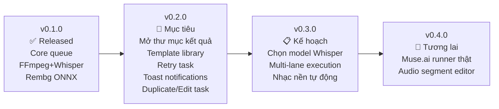

# Kế Hoạch Bổ Sung Tính Năng — Xitrum AI Studio

> Phiên bản hiện tại: **0.1.0** | Ngày lập kế hoạch: 2026-11-05

---

## Tổng Quan

Kế hoạch này liệt kê các tính năng cần bổ sung cho **Xitrum AI Studio** dựa trên phân tích so sánh với **Kahi AI** và nhu cầu thực tế của người dùng. Các tính năng được sắp xếp theo mức độ ưu tiên (giá trị / rủi ro thực thi).

---

## Phân Tích Khoảng Trống Hiện Tại

| Tính năng | Kahi AI | Xitrum hiện tại | Khoảng trống |
|---|---|---|---|
| Mở thư mục kết quả | `results.open/reveal/openFolder` | Chỉ hiển thị path | Nhỏ |
| Thư viện template / prompt | `prompts.list`, `saveCustom` | Chưa có | Lớn |
| Retry task thất bại | `queue.rerun` | Chưa có | Nhỏ |
| Multi-lane execution | `runner.lanes` | Actor đơn | Vừa |
| Chọn model Whisper | Không (bundled) | Fixed `ggml-tiny` | Vừa |
| Tích hợp Muse.ai runner | `runner.*` IPC | Chưa nối thật | Lớn |
| Nhạc nền tự động | `music.pickDir` | Chưa có | Vừa |
| Thông báo in-app | `notices.*` | Chưa có | Nhỏ |
| Audio segment editor | `audio.editSegment` | Chưa có | Lớn |
| Duplicate/Edit prompt | — | Chưa có | Nhỏ |

---

## Ưu Tiên 1 — Giá Trị Cao, Rủi Ro Thấp

### P1-1: Nút "Mở Thư Mục Kết Quả"

**Vấn đề:** Sau khi task hoàn thành, người dùng không thể mở ngay folder output.

**Giải pháp:**
- Thêm nút 📂 vào cột Actions trong bảng Queue
- Gọi Tauri command `open_output_folder(task_id)` → dùng `opener::open()` hoặc `tauri::api::shell::open()` trên `output_path.parent()`
- Nếu `output_path` chưa tồn tại → hiển thị toast lỗi

**Files cần sửa:**
- `src-tauri/src/commands.rs` — thêm `#[tauri::command] fn open_output_folder`
- `src/App.tsx` — thêm nút trong cột Actions
- `src/api.ts` — export `openOutputFolder(taskId)`

**Effort:** ~2h | **Phiên bản mục tiêu:** 0.2.0

---

### P1-2: Thư Viện Template / Prompt

**Vấn đề:** Mỗi lần tạo task đều phải nhập lại prompt, không có tái sử dụng.

**Giải pháp:**
- Thêm bảng SQLite: `templates(id TEXT PRIMARY KEY, name TEXT, prompt TEXT, ratio TEXT, created_at INTEGER)`
- Rust commands: `save_template`, `list_templates`, `delete_template`, `apply_template`
- UI: Tab mới **"Templates"** bên sidebar, danh sách card với nút Apply / Delete
- Khi Apply: điền sẵn form tạo task tương ứng

**Files cần tạo/sửa:**
- `src-tauri/src/db.rs` — thêm migration bảng `templates`
- `src-tauri/src/commands.rs` — thêm 4 commands mới
- `src/components/TemplateLibrary.tsx` — component mới
- `src/App.tsx` — thêm tab Templates
- `src/api.ts` — export wrapper functions

**Effort:** ~6h | **Phiên bản mục tiêu:** 0.2.0

---

### P1-3: Retry Task Thất Bại

**Vấn đề:** Khi task fail (do lỗi path, model crash…), người dùng phải xóa rồi tạo lại từ đầu.

**Giải pháp:**
- Thêm Rust command `retry_task(task_id)`:
  - Reset `status = 'queued'`, `error = NULL`, `progress = 0` trong DB
  - Gửi task vào queue channel lại
- Hiển thị nút 🔄 Retry trong cột Actions khi `status == 'failed'`

**Files cần sửa:**
- `src-tauri/src/commands.rs`
- `src-tauri/src/queue.rs` — expose method `re_enqueue`
- `src/App.tsx` — nút Retry

**Effort:** ~3h | **Phiên bản mục tiêu:** 0.2.0

---

## Ưu Tiên 2 — Giá Trị Vừa, Effort Vừa

### P2-1: Chọn Model Whisper từ Settings

**Vấn đề:** Model `ggml-tiny` nhanh nhưng độ chính xác thấp; người dùng muốn chọn `base` hoặc `medium` cho nội dung phức tạp.

**Giải pháp:**
- Thêm field `whisper_model` vào `AppConfig` (mặc định: `ggml-tiny`)
- Settings tab: dropdown chọn model, hiển thị kích thước file và tốc độ ước tính
- Executor audio đọc `config.whisper_model` để build path `--model <path>`
- Hỗ trợ 3 model đi kèm: `ggml-tiny.bin` (75MB), `ggml-base.bin` (142MB), `ggml-medium.bin` (1.5GB)

> [!NOTE] Model `ggml-medium` cần download riêng (~1.5GB); không bundle vào installer. Thêm nút "Download" trong Settings kích hoạt download qua `tauri-plugin-http`.

**Files cần sửa:**
- `src-tauri/src/models.rs` — thêm field `whisper_model: String`
- `src-tauri/src/executors/audio.rs` — đọc config
- `src/App.tsx` — dropdown trong Settings tab

**Effort:** ~4h | **Phiên bản mục tiêu:** 0.3.0

---

### P2-2: Multi-Lane Execution (Xử Lý Song Song)

**Vấn đề:** Hiện tại chỉ chạy 1 task tại một thời điểm, lãng phí tài nguyên khi task nhẹ.

**Giải pháp:**
- Thêm config: `max_parallel_local: u8` (mặc định 2), `max_parallel_muse: u8` (mặc định 1)
- Dùng `tokio::sync::Semaphore` trong `queue.rs` để giới hạn concurrent tasks theo loại
- Hiển thị lane indicator trong UI (ví dụ: "🟢 Slot 1/2 đang dùng")

**Files cần sửa:**
- `src-tauri/src/queue.rs` — thêm Semaphore logic
- `src-tauri/src/models.rs` — thêm config fields
- `src/App.tsx` — hiển thị slot status

**Effort:** ~5h | **Phiên bản mục tiêu:** 0.3.0

---

### P2-3: Tích Hợp Muse.ai Runner Thật

**Vấn đề:** Tab Video hiện tại chưa thực sự gửi video lên Muse.ai; cần nối sidecar Node.js runner.

**Giải pháp:**
- Tích hợp `sidecar-muse/runner.mjs` (Playwright + Chrome CDP)
- Rust executor mới `executors/muse_runner.rs`:
  - Spawn sidecar `node runner.mjs --task <json>`
  - Đọc stdout JSON-lines: `{"type":"progress","value":50}`, `{"type":"done","url":"..."}`
  - Emit Tauri events `task_progress`, `task_done`
- Xử lý auth expired: emit event `muse_session_expired` → hiển thị dialog hướng dẫn re-login

> [!IMPORTANT] Chrome profile phải tồn tại tại `%APPDATA%\xitrum-ai-studio\chrome-profile\`. Thêm hướng dẫn setup lần đầu.

**Files cần tạo/sửa:**
- `src-tauri/src/executors/muse_runner.rs` — executor mới
- `sidecar-muse/runner.mjs` — JSON-lines protocol
- `src-tauri/src/commands.rs` — `check_muse_session`
- `src/App.tsx` — dialog session expired

**Effort:** ~12h | **Phiên bản mục tiêu:** 0.4.0

---

## Ưu Tiên 3 — Tiện Ích, Effort Thấp–Vừa

### P3-1: Thông Báo In-App (Toast/Banner)

**Vấn đề:** Không có phản hồi trực quan khi task hoàn thành hoặc lỗi.

**Giải pháp:**
- Thêm toast notification system bằng `react-hot-toast` hoặc tự build
- Subscribe sự kiện Tauri: `task_completed`, `task_failed`, `task_progress`
- Toast tự biến mất sau 5 giây; lỗi yêu cầu click để đóng

**Effort:** ~2h | **Phiên bản mục tiêu:** 0.2.0

---

### P3-2: Nhạc Nền Tự Động

**Vấn đề:** Video render xong không có nhạc nền, kém hấp dẫn.

**Giải pháp:**
- Thêm Settings field `music_folder` (pick folder dialog)
- Rust command `mix_music(video_path, music_folder)`:
  - Random pick 1 file `.mp3`/`.wav` từ folder
  - FFmpeg: `ffmpeg -i video.mp4 -i music.mp3 -shortest -filter_complex amix output.mp4`
- Có thể thêm vào queue như một post-process step tùy chọn

**Effort:** ~4h | **Phiên bản mục tiêu:** 0.3.0

---

### P3-3: Audio Segment Editor

**Vấn đề:** Whisper đôi khi nhận dạng sai; không có cách sửa text trước khi render.

**Giải pháp:**
- Sau khi STT hoàn thành, hiển thị danh sách segments: `[00:01.3 → 00:04.7] "text here"`
- Cho phép sửa text trong từng ô
- Nút "Re-render" dùng segments đã sửa + FFmpeg subtitle overlay

**Effort:** ~8h | **Phiên bản mục tiêu:** 0.4.0

---

### P3-4: Duplicate / Edit Task Đang Chờ

**Vấn đề:** Muốn tạo task tương tự với thay đổi nhỏ phải nhập lại từ đầu.

**Giải pháp:**
- Nút ✏️ Edit trên task `queued` → mở form pre-filled
- Nút 📋 Duplicate → tạo bản sao với status `queued`

**Effort:** ~3h | **Phiên bản mục tiêu:** 0.2.0

---

## Lộ Trình Phiên Bản

---

## Ước Tính Effort Tổng

| Phiên bản | Tính năng | Effort ước tính |
|---|---|---|
| v0.2.0 | P1-1, P1-2, P1-3, P3-1, P3-4 | ~16h |
| v0.3.0 | P2-1, P2-2, P3-2 | ~13h |
| v0.4.0 | P2-3, P3-3 | ~20h |
| **Tổng** | | **~49h** |

---

## Checklist Trước Mỗi Release

- [ ] `cargo check` không có lỗi
- [ ] `npm run build` thành công
- [ ] `npm run tauri build` → tạo được `.exe` installer
- [ ] Test thủ công: thêm task → chạy → xem kết quả
- [ ] Cập nhật `nhat-ky-loi-va-sua-loi.md` nếu có lỗi mới
- [ ] Cập nhật `huong-dan-van-hanh-poc.md` nếu có tính năng mới
- [ ] Commit + push lên `github.com/phongsun01/xitrum-AI-studio`
- [ ] Tag version: `git tag v0.x.0 && git push --tags`

---

*Tài liệu này được tạo ngày 2026-11-05. Cập nhật khi hoàn thành từng milestone.*
