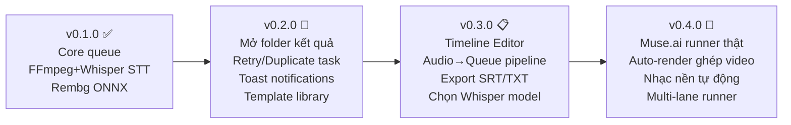

# Kế Hoạch Nâng Cấp Xitrum AI Studio — Phân Tích Từ Kahi AI

> Phiên bản hiện tại: **0.1.0** | Cập nhật: 2026-11-05  
> Nguồn phân tích: Reverse engineering `preload.js` + `main.js` từ Kahi AI v2.1.4

---

## Kahi AI Làm Gì? (Hiểu Đúng Trước Khi Làm)

Kahi AI là ứng dụng **Audio → Video AI** theo pipeline hoàn chỉnh:

```
[1] Import file audio (giọng đọc sẵn)
      ↓ Whisper STT
[2] Timeline segments: câu 1 (0s-3s), câu 2 (3s-7s), ...
      ↓ Timeline Editor (người dùng gắn prompt + ảnh mẫu cho từng câu)
[3] Queue → Muse.ai sinh ảnh/video cho từng segment
      ↓ FFmpeg
[4] Ghép toàn bộ thành 1 video hoàn chỉnh có audio + hình + nhạc nền
```

**Whisper trong Kahi** = chỉ là bước phụ trợ để tách timestamp — không phải mục tiêu chính.  
**Giá trị cốt lõi của Kahi** = Timeline Editor (bước 2) + Auto-render ghép video (bước 4).

---

## Phân Tích Khoảng Trống Dựa Trên IPC Thực Tế

### Namespace `queue` — Kahi IPC đầy đủ:
```
queue.add, queue.addCombo, queue.approve, queue.reject,
queue.list, queue.get, queue.remove, queue.recover,
queue.rerun, queue.editPrompt, queue.duplicate,
queue.newSession, queue.batches
```
**Xitrum có:** `enqueue_task`, `cancel_task`, `list_tasks`  
**Thiếu:** approve/reject, editPrompt, duplicate, recover, newSession

---

### Namespace `runner` — Kahi IPC:
```
runner.start, runner.stop, runner.state, runner.lanes
```
**Xitrum có:** Actor queue đơn luồng + CancellationToken  
**Thiếu:** multi-lane (chạy song song), state expose ra UI

---

### Namespace `audio` — Kahi IPC đầy đủ (27 methods):
```
audio.pick, audio.open, audio.close, audio.start, audio.stop,
audio.view, audio.queue, audio.clips, audio.jobs, audio.busy,
audio.editSegment, audio.editBible, audio.setRefs,
audio.addToQueue, audio.exportScript, audio.exportAudio,
audio.setRender, audio.shuffle, audio.setEffect, audio.pickClip,
audio.render, audio.stopRender, audio.openRender, audio.stopAuto,
audio.refill, audio.regenerate,
audio.batchPick, audio.batchInspect, audio.batchStart,
audio.batches, audio.batch, audio.running, audio.batchPause, audio.batchStop
```
**Xitrum có:** `audio.start` (FFmpeg→WAV→Whisper→JSON)  
**Thiếu:** Toàn bộ phần editor, render, export, batch

---

### Namespace `results` — Kahi IPC:
```
results.open, results.reveal, results.openFolder
```
**Xitrum có:** Hiển thị path text  
**Thiếu:** Nút mở file / mở thư mục

---

### Namespace `music` — Kahi IPC:
```
music.status, music.set, music.pickDir, music.openDir
```
**Xitrum có:** Chưa có gì  
**Thiếu:** Toàn bộ

---

### Namespace `templates` / `prompts` — Kahi IPC:
```
prompts.list, prompts.saveCustom, prompts.importFiles,
templates.list, templates.get
```
**Xitrum có:** Nhập prompt trực tiếp trong form  
**Thiếu:** Thư viện lưu sẵn

---

## Lộ Trình Nâng Cấp



---

## Chi Tiết Từng Phiên Bản

---

### v0.2.0 — Hoàn Thiện UX Cơ Bản
*Mục tiêu: Lấp các lỗ hổng nhỏ, dễ dùng hơn. Effort: ~16h*

- [x] **F1: Nút Mở Thư Mục Kết Quả (`results.reveal` / `results.openFolder`)**
  - Thêm nút 📂 trong cột Actions của bảng Queue, chỉ hiện khi `status = completed`
  - Rust command `open_output_folder(task_id)` → dùng `opener::open(path.parent())`
  - **Files:** `commands.rs`, `App.tsx`, `api.ts`
  - **Effort:** ~2h

- [x] **F2: Retry Task Thất Bại (`queue.rerun`)**
  - Nút 🔄 Retry hiện khi `status = failed`
  - Reset DB: `status='queued', error=NULL, progress=0` → re-enqueue
  - **Files:** `commands.rs`, `queue.rs`, `App.tsx`
  - **Effort:** ~3h

- [x] **F3: Duplicate Task (`queue.duplicate`)**
  - Nút 📋 Duplicate trên task bất kỳ → tạo bản sao với `status='queued'`
  - **Files:** `commands.rs`, `App.tsx`
  - **Effort:** ~2h

- [x] **F4: Edit Prompt Task Đang Chờ (`queue.editPrompt`)**
  - Task ở trạng thái `queued` có thể sửa prompt trước khi chạy
  - **Files:** `commands.rs`, `db.rs`, `App.tsx`
  - **Effort:** ~3h

- [x] **F5: Toast Notifications**
  - Subscribe sự kiện Tauri: `task_completed`, `task_failed`
  - Toast tự biến mất sau 5s, lỗi yêu cầu click đóng
  - Tích hợp ToastContainer inline với animations mượt mà
  - **Files:** `App.tsx`, `components/Toast.tsx`
  - **Effort:** ~2h

- [x] **F6: Template / Prompt Library (`prompts.saveCustom`, `prompts.list`)**
  - Bảng SQLite mới: `templates(id, name, prompt, ratio, created_at)`
  - Rust commands: `save_template`, `list_templates`, `delete_template`
  - UI: Tab **"Thư Viện Templates"** trong sidebar, danh sách card với nút Apply / Delete
  - Khi Apply → điền sẵn form tạo task Video
  - **Files:** `db.rs`, `commands.rs`, `components/TemplateLibrary.tsx`, `App.tsx`
  - **Effort:** ~6h

---

### v0.3.0 — Audio Pipeline Hoàn Chỉnh
*Mục tiêu: Tái hiện workflow Audio→Queue của Kahi. Effort: ~20h*

- [x] **F7: Timeline Segment Editor (`audio.editSegment`, `audio.view`)**
  Đây là **tính năng cốt lõi** của Kahi — đã được tái hiện hoàn chỉnh:
  - Bóc tách STT Whisper tự động phân rã vào bảng `audio_jobs` & `audio_segments`.
  - Hiển thị danh sách timeline: thời gian, lời thoại gốc (sửa được inline), prompt AI tùy biến, ảnh mẫu tham chiếu.
  - Nút "Tạo Video" đẩy từng segment trực tiếp sang hàng đợi Queue Muse.ai.
  - **Files:** `db.rs`, `commands.rs`, `executors/audio.rs`, `components/AudioTimeline.tsx`, `App.tsx`
  - **Effort:** ~12h

- [x] **F8: Export Script (`audio.exportScript`)**
  - Xuất timeline phụ đề chuẩn `.srt` (có căn chuẩn timestamp giờ:phút:giây,mili-giây) hoặc kịch bản `.txt`.
  - Rust command `export_script(job_id, format)`.
  - **Files:** `commands.rs`, `components/AudioTimeline.tsx`
  - **Effort:** ~3h

- [x] **F9: Chọn Model Whisper**
  - Dropdown trong Settings: `ggml-tiny` / `ggml-base` / `ggml-medium`.
  - Lưu cấu hình vào SQLite và tự động truyền model tương ứng vào Whisper executor.
  - **Files:** `models.rs`, `executors/audio.rs`, `App.tsx`
  - **Effort:** ~4h

- [x] **F10: Approve / Reject Kết Quả (`queue.approve`, `queue.reject`)**
  - Nút ThumbsUp / ThumbsDown duyệt hoặc loại bỏ từng segment ngay trên bảng timeline editor.
  - **Files:** `commands.rs`, `db.rs`, `components/AudioTimeline.tsx`
  - **Effort:** ~5h

---

### v0.4.0 — Render Video Hoàn Chỉnh + Runner Thật
*Mục tiêu: Tái hiện toàn bộ pipeline Kahi. Effort: ~30h*

- [ ] **F11: Muse.ai Runner Thật (`runner.start`, `runner.stop`, `runner.lanes`)**
  - Nối sidecar `runner.mjs` (Playwright + Chrome CDP) vào Rust executor
  - JSON-lines stdio protocol: `{"type":"progress","value":50}`, `{"type":"done","url":"..."}`
  - Xử lý session expired: dialog hướng dẫn re-login
  - Rate limiting: nghỉ khi Muse giới hạn gửi (đọc từ Kahi: `pausedUntil`)
  - **Files:** `executors/muse_runner.rs`, `sidecar-muse/runner.mjs`, `App.tsx`
  - **Effort:** ~12h

- [ ] **F12: Auto-Render Ghép Video (`audio.render`)**
  - Sau khi tất cả segment có video từ Muse.ai:
    - FFmpeg concat: `ffmpeg -f concat -i list.txt -i audio.m4a output.mp4`
    - Option: burn subtitle từ segments đã sửa
  - Rust command `render_audio_job(job_id, options)`
  - **Files:** `executors/audio.rs`, `commands.rs`, `App.tsx`
  - **Effort:** ~8h

- [ ] **F13: Nhạc Nền Tự Động (`music.pickDir`, `music.set`)**
  - Settings: chọn thư mục nhạc
  - Khi render: random pick 1 file `.mp3`/`.wav`, FFmpeg auto-mix
  - `ffmpeg -i video.mp4 -i music.mp3 -shortest -filter_complex amix output.mp4`
  - **Files:** `commands.rs`, `App.tsx`
  - **Effort:** ~4h

- [ ] **F14: Multi-Lane Runner (`runner.lanes`)**
  - Config `max_parallel_muse: u8` (default 1) và `max_parallel_local: u8` (default 2)
  - `tokio::sync::Semaphore` giới hạn concurrent tasks theo loại
  - UI hiển thị lane status
  - **Files:** `queue.rs`, `models.rs`, `App.tsx`
  - **Effort:** ~5h

- [ ] **F15: Regenerate Segment (`audio.regenerate`)**
  - Chạy lại Muse.ai cho 1 segment cụ thể nếu kết quả không ưng
  - **Files:** `commands.rs`, `App.tsx`
  - **Effort:** ~2h

---

## Tóm Tắt Effort Và Ưu Tiên

| Phiên bản | Tính năng | Effort | Độ ưu tiên |
|---|---|---|---|
| **v0.2.0** | F1–F6 (UX cơ bản) | ~16h | 🔴 Cao |
| **v0.3.0** | F7–F10 (Audio pipeline) | ~24h | 🟠 Vừa |
| **v0.4.0** | F11–F15 (Render + Runner) | ~31h | 🟡 Thấp |
| **Tổng** | 15 tính năng | **~71h** | |

> [!IMPORTANT] F7 (Timeline Segment Editor) là tính năng quan trọng nhất và khó nhất — đây mới là lý do Kahi trông "chuyên nghiệp hơn". Các tính năng v0.4.0 đều phụ thuộc vào F7 và F11.

> [!TIP] Nên làm v0.2.0 trước để app dùng được tốt hơn ngay, trong khi thiết kế F7 một cách cẩn thận vì nó ảnh hưởng đến toàn bộ kiến trúc DB phần audio.

---

## Checklist Trước Mỗi Release

- [ ] `cargo check` không có lỗi, `npm run build` thành công
- [ ] `npm run tauri build` → tạo được `.exe` installer
- [ ] Test thủ công flow chính
- [ ] Cập nhật `nhat-ky-loi-va-sua-loi.md` nếu có lỗi mới
- [ ] Cập nhật `huong-dan-van-hanh-poc.md` cho tính năng mới
- [ ] `git commit -m "feat: ..."` + `git push` + `git tag vX.Y.Z`

---

*Tài liệu này cập nhật ngày 2026-11-05 dựa trên phân tích IPC thực tế từ Kahi AI v2.1.4.*
