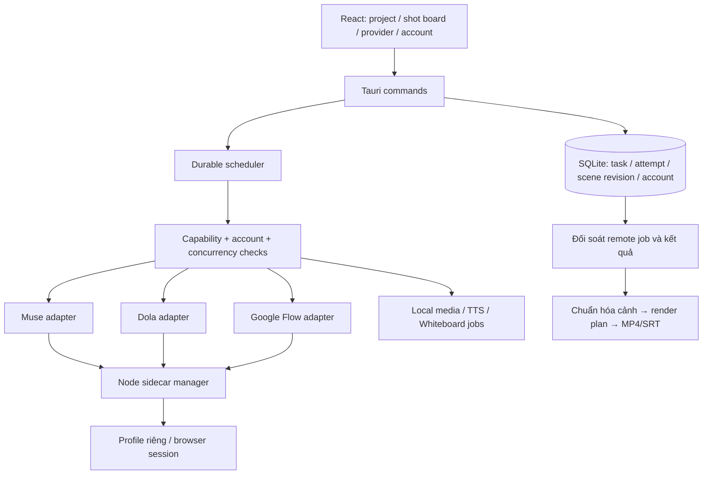

# Kế hoạch triển khai Xitrum AI Studio sau phân tích Sesame

Ngày lập: **07/11/2026**. Baseline: Xitrum AI Studio **0.7.0** trong workspace hiện tại. Trạng thái: **kế hoạch, chưa triển khai các hạng mục dưới đây**.

## 1. Mục tiêu và căn cứ

Hoàn thiện pipeline hiện có và mở rộng từ **Muse** sang **Dola** và **Google Flow/Veo**, giữ kiến trúc React/TypeScript → Tauri/Rust → sidecar Node/Python. Ưu tiên phục hồi công việc, tránh gửi trùng tốn quota và đồng bộ media trước khi mở nhiều provider.

Căn cứ đã đọc:

- [Kiến trúc hệ thống 0.7.0](kien-truc-he-thong.md), nhất là mục 7, 8, 12, 13; 
- Mã `models.rs`, `db.rs`, `queue.rs`, `commands.rs`, các executor, `sidecar-muse/runner.mjs`, cấu hình bundle và frontend liên quan.
- [Báo cáo dịch ngược Sesame 1.0.0](../../reports/sesame-studio-1.0.0/bao-cao-dich-nguoc.md), kèm mã trích xuất và các phụ lục.
- [Kế hoạch tính năng cũ](ke-hoach-bo-sung-tinh-nang.md) là tài liệu lịch sử bắt đầu từ 0.1.0; không dùng các checklist cũ để khẳng định tính năng đã hoạt động trong 0.7.0.

Học cách tổ chức chức năng và khắc phục điểm yếu; triển khai mới trong Rust/TypeScript, không chép nguyên runner Sesame vào sản phẩm. Chỉ thông báo một tích hợp sẵn sàng khi đã có kiểm thử phù hợp; mock không xác nhận dịch vụ thật hoạt động.

## 2. Làm rõ Muse, Dola và Veo 3

### 2.1. Sesame có mã tích hợp nhiều nền tảng thật

| Nhãn | Bằng chứng trong Sesame đã trích xuất | Cách hiểu chính xác |
|---|---|---|
| Muse | `engine/multi-engine.js:8,16,63–65`; `engine/muse-page.js`; `engine/muse-runner.js` | Runner sử dụng phiên web Muse, bridge React/runtime để gửi và lấy kết quả |
| Dola AI | `engine/multi-engine.js:11,19,60–61,81–84`; `engine/dola-runner.js:41,150–184` | Runner riêng cho `www.dola.com`; bật tab Video và kiểm tra nhãn Seedance trước khi gửi |
| Google Flow / Veo | `engine/multi-engine.js:9,17,54–55,98–101`; `engine/gflow-runner.js:310,362,653–654,766–801` | Tích hợp qua web Flow, RPC nội bộ và DOM fallback; không phải model Veo chạy cục bộ |
| Seedance qua BytePlus | `engine/seedance-runner.js:31,398–407,462–480,512–574` | Một route riêng: playground hoặc API key, khác với dùng Seedance qua website Dola |

Các đường dẫn trong bảng tính từ `reports/sesame-studio-1.0.0/extracted/resources/app/` ở workspace cha. Đây là quan sát mã tĩnh của mẫu đã có SHA-256 trong báo cáo; chưa chạy để xác nhận account, quota hoặc website hiện tại.

**Muse và Dola là nền tảng; Veo là dòng model của Google.** Flow là sản phẩm có thể cung cấp model Veo. Vì vậy câu quảng cáo “dùng Muse, Dola, Veo 3” mô tả các đường sử dụng khác loại, không có nghĩa ba engine offline được nhúng vào Sesame. Google mô tả Flow là công cụ làm phim dùng các model của họ trong [bài giới thiệu Flow](https://blog.google/innovation-and-ai/products/google-flow-veo-ai-filmmaking-tool/).

**Chưa đủ bằng chứng khẳng định Sesame luôn chọn đúng Veo 3.** Comment `gflow-runner.js:2` ghi “Veo 3.1 / Omni Flash”, nhưng nhánh request tại `:435–473` dựng các mã `abra_t2v_*`, `abra_i2v_*`, `abra_r2v_*`. Chưa xác minh ánh xạ các mã đó sang model thương mại. DOM fallback còn phụ thuộc model đang chọn trong phiên Flow. Tên runner, comment và truy cập Flow không thay thế bằng chứng model được dùng cho từng lượt sinh.

[Google Flow Help](https://support.google.com/flow/answer/16352836?hl=en) hiện phân biệt nhiều model và giới hạn tính năng theo model/gói tài khoản, đồng thời khuyên kiểm tra model đang chọn trước khi tạo. Do đó phải lưu model theo task và xác minh tại lúc submit; không hard-code lời quảng cáo “mọi task Flow = Veo 3”. Thông tin dịch vụ được tham khảo ngày 07/11/2026, phải kiểm tra lại lúc triển khai adapter.

### 2.2. Xitrum hiện tại mới có Muse cho sinh ảnh/video cloud

`TaskKind` hiện gồm `MuseVideo`, `MuseImage`, `WhisperStt`, `Rembg`, `FfmpegRender` (`src-tauri/src/models.rs:6–11`). Queue và runner cloud đi tới Muse; chưa có adapter Dola, Google Flow hoặc Veo API.

Gemini Vision trong `analyze_image` chỉ phân tích ảnh thành descriptor; **không phải tích hợp Veo sinh video**. VieNeu, Whisper, Rembg và Whiteboard là các pipeline khác, không thay thế provider tạo video cloud.

Đích sản phẩm cần hiển thị tách biệt:

```text
Nền tảng: Muse | Dola | Google
Kết nối: Web Muse | Web Dola | Web Flow | API Google (mở rộng sau)
Model: giá trị đã xác minh; nếu chưa biết phải hiển thị chưa xác định
Tài khoản: profile/credential tương ứng đúng nền tảng và kết nối
```

MVP mở rộng đạt ba route: `muse_web`, `dola_web`, `google_flow_web`. `google_veo_api` là route bổ sung độc lập, không tự coi account/credits web Flow là quyền dùng API. Nếu đánh giá thực tế cho thấy API phù hợp hơn, có thể thay route Google MVP sau khi cập nhật phạm vi và điều kiện credential; không âm thầm đổi cơ chế tính phí.

## 3. Nguyên tắc thiết kế

- Giữ SQLite làm nguồn trạng thái bền vững; channel truyền task ID thay vì snapshot lâu ngày.
- Chuyển trạng thái bằng transaction/điều kiện để tác vụ hủy không bị kết quả muộn ghi đè.
- Retry sau timeout phải đối soát job từ xa trước; nếu không biết đã submit hay chưa, chuyển sang cần kiểm tra thay vì tự gửi lại. Không hứa exactly-once qua dịch vụ không hỗ trợ idempotency.
- Provider/account/model được chọn tường minh và kiểm tra capability trước khi gửi. Không đổi provider ngầm theo regex prompt hay khi hết quota.
- Secret vào kho bí mật OS; DB giữ định danh credential và metadata. Không log cookie, key, mật khẩu hoặc payload nhạy cảm đầy đủ.
- Tách trạng thái feature: chưa cấu hình, thiếu dependency, thử nghiệm, đã kiểm chứng. Không trả video demo thay kết quả thật.
- Không tự động vượt CAPTCHA; báo cần thao tác người dùng. Kiểm thử dịch vụ thật chỉ khi có tài khoản và phạm vi sử dụng/quota được cho phép.

## 4. Kiến trúc và dữ liệu đích



Các thay đổi dữ liệu dự kiến, tên cuối cùng chốt khi implementation:

| Nhóm | Trường/bảng đề xuất | Yêu cầu migration |
|---|---|---|
| Task | `provider`, `connection_mode`, `requested_model`, `observed_model`, `account_id`, `scene_revision`, `generation_key` | Task Muse cũ map sang `muse_web`; model chưa biết giữ null, không tự gán |
| Attempt | task ID, attempt ID, phase, remote job/session/page ID, submit time, error code | Lưu trước/sau submit; lưu đủ để đối soát và phân biệt các lần retry |
| Account | provider, profile path, credential reference, readiness, cooldown | Profile riêng theo account; không dùng chung profile cho hai browser đồng thời |
| Scene/project | revision, approval, active task/result, render status/output manifest | Snapshot cũ không ghi đè kết quả nền của revision mới |
| Render | plan/manifest, clip provenance, duration thật, warning, MP4/SRT output path | Phân biệt preview có placeholder và final đầy đủ |

Tạo migration có phiên bản, backup DB và transaction; kiểm thử nâng cấp DB cũ trước khi thêm nhiều cột/trạng thái. Chuyển dần task sinh video sang operation chung + provider, vẫn đọc được `muse_video/muse_image` trong dữ liệu cũ. Không đổi serialization một lần khiến task cũ không parse được.

Adapter contract dự kiến: `capabilities`, `check_session`, `submit`, `poll_or_reconcile`, `download_result`, `cancel`, `close`. Provider không hỗ trợ một operation phải trả capability/error rõ; đóng trang local không được báo là đã hủy job trên server. JSON-lines dùng request ID và attempt ID, stdout chỉ là protocol, log sang stderr; mọi chờ đều có timeout và cleanup.

## 5. Lộ trình triển khai và tiêu chí nghiệm thu

### G0 — Baseline, migration và đóng gói (P0)

Việc làm:

- Chốt fixture DB 0.7.0 và hành vi hiện tại của Muse/Audio/Whiteboard; bổ sung migration versioned.
- Đóng gói ba thư mục sidecar và dependency/runtime theo chính sách phát hành; dùng resource path thay vì phụ thuộc current directory.
- Thêm màn hình kiểm tra Node/Python/browser/FFmpeg/model; chỉ rõ dependency nào thiếu và tính năng bị ảnh hưởng.
- Đưa secret vào Keychain trên macOS và credential store phù hợp trên Windows; chuyển password proxy XOR/Gemini localStorage theo migration không làm mất cấu hình. Kho bí mật lỗi phải báo lỗi, không tự rơi về plaintext.

Điểm sửa: `tauri.conf.json`, `lib.rs`, `state.rs`, executor path resolvers, `commands.rs`, `db.rs`, `src/api.ts`, settings UI.

Nghiệm thu: bản cài mở từ ngoài repository vẫn tìm đúng sidecar; smoke test macOS/Windows; migration giữ dữ liệu cũ và rollback từ backup được; không xuất secret ra frontend/log ngoài phạm vi cần thiết.

### G1 — Queue bền vững, hủy và chống gửi trùng (P0)

Việc làm:

- Queue nhận ID; đọc lại task/revision ngay trước thực thi. Startup nạp lại pending; tác vụ đã submit từ xa đi qua reconcile.
- Thêm attempt/phase và generation key từ scene revision, prompt, provider, requested model, tham số và hash ảnh. Dùng DB constraint/transaction để chống hai lần dispatch cùng một generation.
- Cho phép “Tạo biến thể mới” bằng generation mới tường minh; không vô tình chặn người dùng muốn sinh thêm.
- Cancellation-aware khi chờ semaphore; giữ terminal state, dọn token và process; stale attempt không ghi đè kết quả mới.
- Enqueue và liên kết scene/segment cùng transaction hoặc outbox có khả năng phục hồi. Kind chưa có executor phải fail rõ.

Điểm sửa: `queue.rs`, `db.rs`, `models.rs`, `commands.rs`, `executors/muse_runner.rs`, `sidecar-muse/runner.mjs`.

Nghiệm thu: restart với pending/running; timeout sau submit không gửi lại mù; double-click dispatch không tạo hai job; sửa prompt pending được dùng; cancel trước permit không chạy; kết quả cũ không ghi đè attempt mới. Có test tình huống thiếu remote ID → cần kiểm tra, không tự tái submit.

### G2 — Timeline media và đầu ra trung thực (P0)

Việc làm:

- Tạo render plan dùng mốc thời gian số nguyên ms, dựa duration audio thật và chính sách scene; probe video/audio trước khi lập plan.
- Chuẩn hóa scale/pad, SAR, fps, pixel format và audio layout/sample rate cho từng clip trước concat.
- Chốt chính sách video ngắn/dài: trim, điều chỉnh tốc độ có giới hạn, freeze frame; audio vượt ô phải kéo dài scene hoặc báo cần sửa, không âm thầm cắt lời.
- Sinh SRT từ cùng render plan; audio timeline bỏ segment phải áp dụng cùng quyết định lên audio gốc. Chỉ định `-map` rõ.
- Chế độ Final yêu cầu đủ clip hợp lệ; Preview được dùng placeholder nhưng hiển thị danh sách cảnh thiếu. Lưu manifest provenance và MP4/SRT vào DB; dọn temp cả khi lỗi/hủy.

Điểm sửa: `commands.rs::render_script_postproduction`, `render_audio_job`, `executors/audio.rs`; tách module render planner mới; editor/player và model kết quả.

Nghiệm thu: input khác độ phân giải/fps/audio, thiếu audio, clip ngắn hơn giọng, ratio 9:16/16:9/1:1, segment reject. Tổng duration MP4 và render plan lệch không quá 100 ms hoặc 2 frame (lấy mức lớn hơn); subtitle chốt theo timeline; final thiếu clip phải bị chặn. Preview không được báo là final đầy đủ.

### G3 — Khung provider và account (P1, sau G1)

Việc làm:

- Tách điều phối khỏi `MuseRunner`; bọc Muse hiện tại bằng adapter contract và giữ chức năng tương thích.
- Profile/account riêng; giới hạn theo provider và account, cooldown/backoff, login/CAPTCHA-required. TTS/render có resource budget riêng thay vì chạy vô hạn ngoài queue.
- Capability matrix cho operation, ratio, duration, số ảnh, native audio và khả năng resume/cancel. Model chưa xác minh không được giả định capability.
- UI chọn provider → connection → model → account. Log kết quả có requested/observed model và bằng chứng xác minh; không có thì ghi unknown.

Điểm sửa: `models.rs`, `db.rs`, `queue.rs`, executor registry mới, `src/api.ts`, `App.tsx`, `IdeaScriptEditor.tsx`, settings/account UI và sidecar manager.

Nghiệm thu: Muse chạy qua abstraction mới; DB cũ đọc được; chọn account sai provider bị chặn trước submit; model/ratio không hỗ trợ không bị đổi ngầm; mọi task hiển thị đúng route/attempt/account.

### G4 — Tích hợp Dola (P1, sau G3)

Việc làm:

- Khảo sát bằng account được cung cấp: URL, login, tab Video, model thực, upload, submit, trạng thái và download. Trước đó chỉ làm được adapter/mock/fixtures; không báo ready dịch vụ thật.
- Triển khai Dola sidecar adapter bằng Playwright; xác nhận đang ở Video và model/capability phù hợp trước khi submit. Không chọn engine chỉ theo tên quảng cáo.
- Ghi remote/page/job identity khi có; kiểm tra MIME/ffprobe/hash kết quả, không lấy media cũ trên trang làm kết quả mới.
- Xử lý quota, hết phiên, thay DOM, timeout sau submit và đóng phiên có giới hạn. Không tự chuyển Muse khi Dola lỗi.

Nghiệm thu: text-to-video và image-to-video nếu account hỗ trợ; ratio/duration đúng; media thuộc attempt mới; restart/timeout không nhân đôi job; lỗi login/quota rõ; có bản ghi kiểm thử dịch vụ thật và account/model được dùng. Capability không có phải ẩn/vô hiệu hóa.

### G5 — Google Flow và xác minh Veo (P1, sau G3; có thể độc lập G4)

Việc làm:

- Khảo sát Flow hiện tại với account thực; ghi model/operation được quyền dùng. Không mang nguyên RPC IDs hoặc model `abra_*` của Sesame sang Xitrum.
- Đường web MVP: adapter Playwright có selector versioned, xác nhận model đang chọn, upload ảnh, submit một lần, theo dõi và download đúng kết quả.
- Chỉ gắn nhãn Veo khi UI/provider response xác lập model tương ứng; task Flow chưa biết model vẫn hiển thị unknown. Nếu Flow đề nghị đổi model, dừng để người dùng chọn thay vì tự đổi.
- Tách requested model và observed model. Hỗ trợ continuity qua frame cuối khi capability cho phép; lưu provenance ảnh, không hứa giữ mặt tuyệt đối.
- Route API Google là work package riêng: xác minh tài liệu API/quyền truy cập/model hiện hành, credential và chi phí trước khi triển khai. Không coi Gemini Vision đang có là backend video.

Nghiệm thu: có ít nhất một ca sinh video trên model Veo được xác minh nếu account cho phép, lưu bằng chứng model không chứa secret; kiểm tra text/image input theo capability, hết quota, đổi model, timeout/reconcile, tải đúng clip. Nếu thiếu account hoặc model không có quyền, giữ trạng thái chưa kiểm chứng; không công bố “đã hỗ trợ Veo 3”.

### G6 — Shot board, revision và continuity (P1/P2, sau G1–G3)

Việc làm:

- Trạng thái scene draft → approved → held/queued → running → result; sửa input sinh làm revision mới và hủy hiệu lực approval cũ.
- Cho chọn chỉ cảnh thiếu/đã thay đổi, render lại một cảnh hoặc biến thể; giữ lịch sử kết quả và task hiện hành.
- Lưu ảnh Character/Product/Environment tham chiếu theo hash; chọn nhiều ảnh chỉ khi provider hỗ trợ, còn lại yêu cầu người dùng quyết định.
- Tùy chọn frame cuối cảnh trước, preview ảnh trước submit; dependency giữa cảnh phải chờ kết quả trước, không song song sai thứ tự.

Nghiệm thu: snapshot UI cũ không ghi đè đường audio/video nền mới; sửa một scene không sinh lại cả project; không thay kết quả hiện hành bằng attempt/revision cũ; cảnh held không tự gửi.

### G7 — TTS batch và quan sát pipeline (P2)

Việc làm: Python worker giữ model nóng có idle shutdown; batch theo scene/voice, request ID, progress/cancel, deadline và restart một lần có kiểm soát. Cache audio theo text/voice/speed/model version; đổi input phải invalidation. Đo hiệu năng cold/warm và bộ nhớ trước/sau. Voice catalog lấy từ backend thực, không dùng số lượng README làm bằng chứng.

Nghiệm thu: nhiều scene liên tiếp không nạp model lại không cần thiết; request lỗi không làm treo hàng đợi; âm thanh cache đúng input; không chạy đồng thời gây quá bộ nhớ; số đo được ghi vào docs thay vì hứa tỷ lệ tăng tốc trước khi benchmark.

## 6. Thứ tự và cách chia thay đổi

```text
G0 → G1 → G2
      └→ G3 → G4 (Dola)
             └→ G5 (Flow/Veo)
G1 + G2 + G3 → G6
G0 + resource budget từ G3 → G7
```

Đợt triển khai đầu tiên: **G0–G2**, tạo nền ổn định cho Muse đang có. Đợt mở rộng cloud: **G3–G5**, mục tiêu người dùng chủ động chọn Muse/Dola/Flow và biết model thật. Đợt hoàn thiện sản xuất: **G6–G7**. Không gắn số phiên bản release hoặc thời hạn chắc chắn trước khi kiểm thử baseline và khảo sát account provider.

Mỗi PR nên độc lập theo một thay đổi có thể nghiệm thu: migration → phục hồi queue → cancel/dedup → render planner → chuẩn hóa media → registry/Muse adapter → account UI → Dola → Flow/model verification → shot board → TTS worker. Tránh dồn thay schema, sửa queue và hai provider mới vào một PR.

## 7. Kiểm thử và điều kiện hoàn thành

| Lớp | Kiểm thử bắt buộc |
|---|---|
| DB | Migration từ fixture 0.7.0, transaction, uniqueness generation, stale revision/attempt |
| Queue | Restart, cancel trước/sau permit, timeout sau submit, lỗi DB, retry/reconcile, giới hạn provider/account |
| Protocol | Request ID, stdout lẫn log, response sai, helper crash/hang, cleanup và deadline |
| Media | Bộ clip tổng hợp nhỏ với duration/ratio/fps/audio khác nhau; kiểm tra bằng ffprobe; SRT và manifest |
| UI | Chọn route/model/account, capability không hỗ trợ, shot approval, trạng thái demo/preview/final |
| Provider thật | Account/model thực có quyền sử dụng, submit một lần, tải đúng kết quả mới, hết phiên/quota; không dùng mock làm chứng nhận |
| Release | Bản cài macOS và Windows mở ngoài repo, không có working-directory dependency; có thông báo dependency thiếu |

Kiểm tra theo phần thay đổi: frontend `npm run build`; Rust `cargo check`/test liên quan và Tauri release smoke; Whiteboard giữ smoke test đang có. Bổ sung test cho hành vi nghiệp vụ/race/recovery, không chỉ snapshot implementation.

Checklist bàn giao mỗi giai đoạn: code + migration, test phù hợp, cập nhật `kien-truc-he-thong.md`/hướng dẫn vận hành, giới hạn còn lại và bằng chứng chạy thực. README chỉ cập nhật sau khi nghiệm thu, phân biệt local/offline với cloud cần account/quota.

## 8. Những phần không đưa vào phạm vi ngay

Chưa thêm Facebook publishing, CRM HTTP server, hàng loạt logo TTS chưa có backend hoặc AUTO tự chọn provider bằng regex. Chưa có nhu cầu sản phẩm đủ rõ để tăng thêm các bề mặt đó. Seedance qua BytePlus API/playground là provider mở rộng sau, khác work package Dola. Không chạy dịch vụ thật, cài dependency mới hay sửa source code trong bước lập kế hoạch này.

Đầu vào cần có khi đến G4/G5: account/profile đúng dịch vụ, model/capability được cấp, mức sử dụng cho phép và mẫu text/ảnh kiểm thử. Các phần G0–G3, media và test offline có thể làm trước mà không phụ thuộc account này.

---

## 9. Báo cáo tiến độ triển khai thực tế (Cập nhật 07/11/2026)

| Giai đoạn | Trọng tâm | Trạng thái | Phiên bản / Ghi chú bàn giao |
|---|---|---|---|
| **G0** | Nền tảng DB, queue schema, state machine & retry | **ĐÃ HOÀN THÀNH** | v0.7.1 - Đã bổ sung migration, `idempotency_key`, trạng thái job `Cancelled`/`FailedRecoverable`, crash recovery khi khởi động studio. |
| **G1** | Chống gửi trùng, cơ chế Cancel & Phục hồi việc | **ĐÃ HOÀN THÀNH** | v0.7.1 - Đã kiểm thử logic deduplication, xử lý timeout, abort controller và hủy task an toàn cả trên Rust lẫn sidecar runner. |
| **G2** | Media alignment, SRT drift fix, Stitcher & FFmpeg | **ĐÃ HOÀN THÀNH** | v0.7.2 - Hoàn thiện đồng bộ phụ đề SRT, pipeline Whiteboard multi-scene (W1-W5), chuẩn hóa timescale audio/video, hỗ trợ resume khi đứt quãng và cảnh báo thiếu audio. |
| **G3** | Provider Registry, Account & Session Manager | **CHUẨN BỊ TRIỂN KHAI** | Thiết kế khung Provider Adapter trừu tượng (Capabilities, Quota, Session Store). Chuẩn bị sẵn sàng trước khi kết nối Dola (G4) và Flow (G5). |
| **G4** | Tích hợp Dola AI Web Adapter | Chưa triển khai | Chờ G3. |
| **G5** | Tích hợp Google Flow / Veo Adapter | Chưa triển khai | Chờ G3. |
| **G6** | Shot Board, Revision & Visual Continuity | Chưa triển khai | Chờ G3. |
| **G7** | TTS Worker nóng & Bộ nhớ đệm âm thanh | Đang tích hợp cục bộ | Đã có VieNeu-TTS song song SRT; sẽ tối ưu batch & keep-alive theo G7. |
