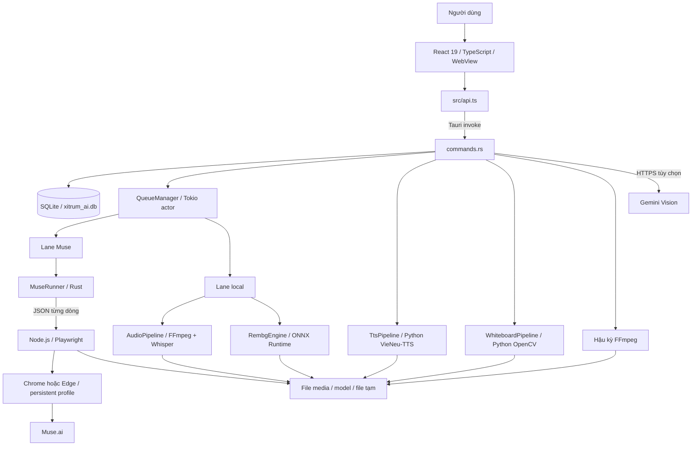
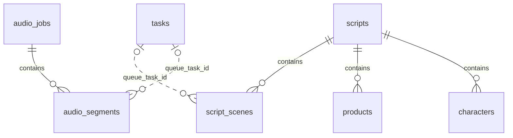
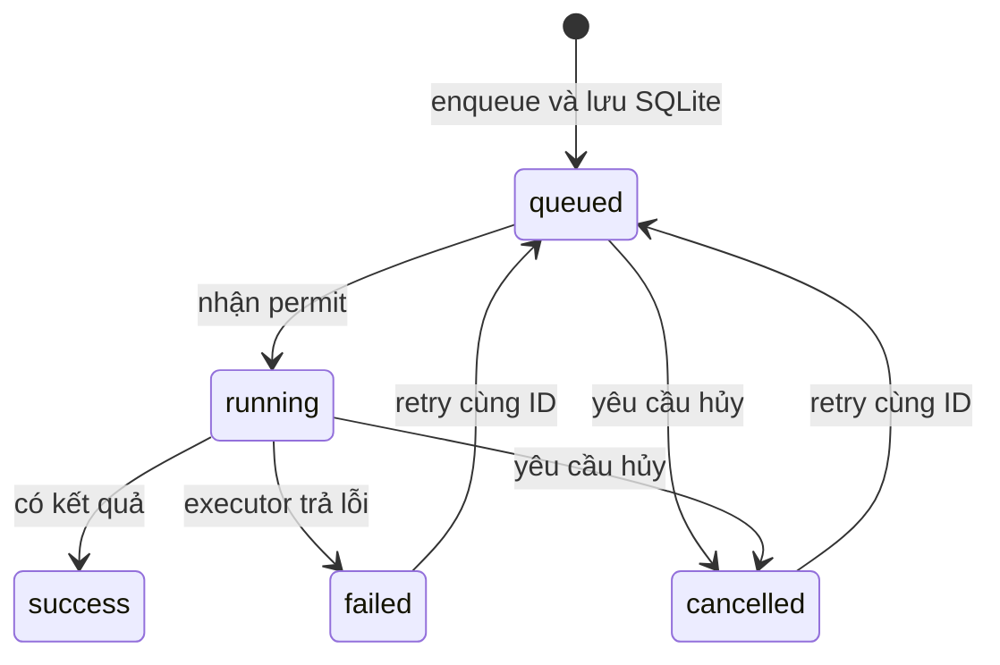

# Kiến trúc hệ thống Xitrum AI Studio

Tài liệu mô tả mã nguồn phiên bản **0.7.0**, đối chiếu ngày **07/11/2026**. Các hành vi dưới đây được xác định qua mã nguồn; không đồng nghĩa mọi tính năng đã được kiểm thử đầu cuối trên mọi hệ điều hành. Những khác biệt giữa mô tả trong README và triển khai được ghi riêng ở cuối tài liệu.

## 1. Mục đích và phạm vi

Xitrum AI Studio là ứng dụng desktop tạo và xử lý video, audio, ảnh. Người dùng thao tác trên giao diện React; Rust lưu dữ liệu, điều phối công việc và gọi các engine chuyên biệt.

Các luồng nghiệp vụ chính:

- Ý tưởng → prompt mẫu cho chatbot bên ngoài → nhập kịch bản JSON → chỉnh cảnh, nhân vật, sản phẩm → TTS → sinh clip qua Muse → hậu kỳ MP4 và SRT.
- Audio → FFmpeg chuẩn hóa → Whisper nhận dạng → biên tập timeline → sinh clip từng đoạn → ghép video với audio gốc.
- Prompt → sinh video hoặc ảnh qua trình duyệt Muse; xóa nền ảnh bằng ONNX trên máy.
- SRT và ảnh line-art → annotation chia vùng → hoạt hình bảng trắng → ghép cảnh.

Ứng dụng không có backend HTTP riêng hay tài khoản người dùng riêng. Tuy nhiên, việc sinh ảnh/video Muse và phân tích ảnh Gemini cần dịch vụ bên ngoài. Chỉ các engine xử lý tại máy mới thuộc phạm vi offline, với điều kiện đã chuẩn bị runtime, thư viện và model cần thiết.

## 2. Sơ đồ tổng thể



Hai kênh giao tiếp cần phân biệt:

1. **Frontend ↔ Rust:** IPC của Tauri qua `invoke`, không gọi REST API nội bộ.
2. **Rust ↔ Node/Python:** các dòng JSON trên stdin/stdout. Mã nguồn gọi một số kênh là JSON-RPC, nhưng message thực tế dùng `action` và `type`, không phải envelope JSON-RPC 2.0 chuẩn.

## 3. Bản đồ mã nguồn

| Đường dẫn | Vai trò |
| --- | --- |
| `src/main.tsx` | Mount ứng dụng React. |
| `src/App.tsx`, `src/App.css` | Shell giao diện, chuyển tab, settings, bảng task, polling và thông báo. |
| `src/api.ts` | Kiểu dữ liệu TypeScript, wrapper IPC và hộp thoại chọn file/thư mục. |
| `src/components/IdeaScriptEditor.tsx` | Nhập JSON, Character Bible, sản phẩm, prompt lock, TTS, dispatch và hậu kỳ. |
| `src/components/AudioTimeline.tsx` | Biên tập segment, duyệt nội dung, tạo lại clip, xuất SRT/TXT, ghép video. |
| `src/components/WhiteboardEditor.tsx` | Chọn SRT/ảnh/annotation, sinh annotation và render một cảnh bảng trắng. |
| `src/components/ProxyManager.tsx` | Nhập, kiểm tra, chọn và xóa proxy. |
| `src/components/TemplateLibrary.tsx`, `Toast.tsx` | Thư viện prompt và thông báo giao diện. |
| `src-tauri/src/main.rs`, `lib.rs` | Entry point native, logging, plugin, bootstrap và đăng ký command. |
| `src-tauri/src/state.rs` | State dùng chung: database, queue và whiteboard pipeline. |
| `src-tauri/src/commands.rs` | API native và orchestration nghiệp vụ, gồm cả hậu kỳ kịch bản. |
| `src-tauri/src/models.rs`, `errors.rs` | Mô hình dữ liệu, cấu hình và lỗi serialize về frontend. |
| `src-tauri/src/db.rs` | Schema SQLite, migration đơn giản, CRUD và liên kết kết quả task. |
| `src-tauri/src/queue.rs` | Hàng đợi trong bộ nhớ, giới hạn đồng thời, chạy và hủy tác vụ. |
| `src-tauri/src/executors/` | Adapter Rust cho Muse, audio, Rembg, TTS và whiteboard. |
| `sidecar-muse/runner.mjs` | Điều khiển trình duyệt và tải kết quả Muse. |
| `sidecar-tts/tts_runner.py` | Liệt kê giọng, gọi VieNeu-TTS và đo thời lượng WAV. |
| `sidecar-whiteboard/whiteboard_runner.py` | Router giao thức cho parse SRT, annotation, render và merge. |
| `sidecar-whiteboard/scripts/` | Thuật toán phân cảnh, hình học mask, nét vẽ, encoding và ghép video. |
| `src-tauri/resources/selectors.default.json` | Selector giao diện Muse, ghi đè selector mặc định của runner. |
| `src-tauri/tauri.conf.json`, `capabilities/default.json` | Build, bundle, cửa sổ và quyền WebView. |
| `docs/` | Hướng dẫn vận hành, kế hoạch phát triển và tài liệu kiến trúc này. |

## 4. Khởi động và vòng đời

1. `lib.rs::run()` thiết lập tracing ra stdout và file `xitrum_debug.log` trong thư mục tạm hệ điều hành.
2. Tauri nạp plugin shell, dialog và single-instance. Callback single-instance hiện để trống.
3. Trong `setup`, backend xác định `app_local_data_dir()` theo identifier `com.xitrum.ai.studio`; nếu thất bại thì dùng thư mục tạm `XitrumAI`.
4. Tạo hoặc mở `xitrum_ai.db`, bật foreign key, tạo bảng, thêm cột còn thiếu và seed template nếu chưa có.
5. `AppState::new()` tạo `Arc<Database>`, `Arc<QueueManager>` và `Arc<WhiteboardPipeline>`.
6. Queue đọc cấu hình, tạo semaphore hai lane, thử nạp model Rembg và khởi động actor Tokio.
7. React tải đồng thời task, settings, template; sau đó cứ **1.500 ms** tải lại task và số slot còn trống.

Muse và Whiteboard được khởi động khi cần. Muse giữ một runner dùng chung, có kiểm tra tiến trình và reset khi hủy; Whiteboard giữ tiến trình dùng chung và có thử khởi động lại một lần khi giao tiếp lỗi. TTS tạo tiến trình mới cho mỗi lần liệt kê giọng hoặc synthesize, rồi gửi `exit` và kết thúc tiến trình.

## 5. Frontend và hợp đồng IPC

Frontend dùng React state và props, không có Redux hay router riêng. `App.tsx` chuyển tab bằng state; các editor giữ state của mình và gọi backend qua `api`.

| Nhóm command | Điểm vào chính |
| --- | --- |
| Task/queue | `list_tasks`, `enqueue_task`, `cancel_task`, `retry_task`, `duplicate_task`, `edit_task_prompt`, `get_lane_status` |
| File/settings/template | `open_output_folder`, `get_settings`, `save_settings`, `save_template`, `list_templates`, `delete_template` |
| Audio timeline | `list_audio_jobs`, `list_audio_segments`, `update_audio_segment`, `add_segment_to_queue`, `regenerate_segment`, `export_script`, `render_audio_job` |
| Kịch bản | `save_script_project`, `get_script_project`, `list_script_projects`, `update_script_scene`, `update_character_ref_image`, `delete_script_project`, `dispatch_script_to_queue` |
| TTS/hậu kỳ | `list_tts_voices`, `generate_scene_tts`, `preview_tts_voice`, `render_script_postproduction` |
| Dịch vụ ngoài/proxy | `check_muse_session`, `check_muse_session_by_cookie`, `analyze_image`, `add_proxies`, `list_proxies`, `test_proxy`, `delete_proxy`, `delete_dead_proxies` |
| Whiteboard | `parse_whiteboard_srt`, `generate_whiteboard_annotation`, `render_whiteboard_scene`, `merge_whiteboard_scenes` |

Rust đăng ký các command trong `tauri::generate_handler!`. Wrapper TypeScript thường gửi tham số camelCase, còn hàm Rust dùng snake_case; model trả về dùng các trường snake_case như `output_path`, `queue_task_id`.

`AppError` gom lỗi SQLite, IO, JSON, queue, not-found và lỗi khác, rồi serialize thành chuỗi cho Promise phía frontend. Một số command trả kết quả nghiệp vụ dạng `{ ok, message }` thay vì reject Promise; giao diện cần kiểm tra cả hai trường hợp.

Gemini API key được giữ trong WebView `localStorage` với khóa `xitrum_gemini_api_key`, không nằm trong `AppConfig`. Cookie nhập để kiểm tra Muse nằm trong React state; command này không cài cookie đó vào profile trình duyệt của runner.

## 6. Lưu trữ và mô hình dữ liệu

SQLite dùng `rusqlite` với một `Connection` được bảo vệ bằng `std::sync::Mutex`. Media được lưu dưới dạng file; database chủ yếu giữ metadata và đường dẫn.

| Bảng | Nội dung và quan hệ |
| --- | --- |
| `tasks` | Kind, status, prompt, ratio, input/output path, progress, error và timestamp. |
| `settings` | Key/value; `app_config` chứa toàn bộ `AppConfig` dạng JSON. |
| `templates` | Tên, prompt và ratio; có năm template mặc định khi bảng trống. |
| `audio_jobs` | File audio gốc và trạng thái xử lý. |
| `audio_segments` | Thuộc một audio job; thứ tự, start/end theo ms, text/prompt, ảnh tham chiếu, approval, task và video kết quả. |
| `scripts` | Tiêu đề, ý tưởng, thể loại, ratio, thời lượng mục tiêu, trạng thái và environment lock. |
| `characters` | Thuộc script; mô tả, voice, ảnh, identity lock và cờ locked. |
| `products` | Thuộc script; mô tả, ảnh, product lock và cờ locked. |
| `script_scenes` | Thuộc script; narration, visual/video prompt, nhân vật, duration, audio/video, task, sản phẩm, camera moves và style. |
| `proxies` | Scheme, host, port, username, password đã làm rối, trạng thái, IP và latency. |



Quan hệ task trong sơ đồ là liên kết logic: `queue_task_id` không có foreign key. `script_scenes.character` tra nhân vật bằng tên; `product_id` cũng không khai báo foreign key. Các quan hệ con trực tiếp với script/audio job có `ON DELETE CASCADE`.

`save_script_project()` dùng transaction: ghi script, xóa tập characters/products/scenes cũ rồi chèn lại toàn bộ snapshot. Vì vậy việc lưu project phải sử dụng dữ liệu mới nhất, tránh ghi đè đường dẫn audio/video do công việc nền vừa cập nhật. `camera_moves` được lưu thành chuỗi JSON trong cột TEXT.

Migration hiện thực hiện bằng `CREATE TABLE IF NOT EXISTS` và các lệnh `ALTER TABLE` bỏ qua lỗi; chưa có bảng quản lý phiên bản migration.

## 7. Hàng đợi và thực thi đồng thời

`QueueManager` là actor nhận `QueueAction::Enqueue` hoặc `Cancel` qua Tokio `mpsc` có buffer **100**. Enqueue ghi task `queued` vào SQLite trước, rồi gửi bản sao task vào channel. Actor tạo cancellation token, spawn một future cho task và chờ permit của lane tương ứng.

| Lane | Loại task | Cấu hình mặc định |
| --- | --- | --- |
| Muse | `muse_video`, `muse_image` | `max_parallel_muse = 1` |
| Local | `whisper_stt`, `rembg`, các kind còn lại | `max_parallel_local = 2` |

Semaphore được tạo lúc khởi động, với giá trị tối thiểu 1. Lưu settings không thay đổi semaphore đang tồn tại; phải khởi động lại để áp dụng số slot mới.

Luồng trạng thái thông thường:



Đây là luồng mong đợi; các vấn đề hủy và phục hồi thực tế được nêu ở mục 13. Duplicate tạo task ID mới; retry dùng ID cũ. Progress được executor cập nhật vào SQLite, frontend đọc bằng polling. Chưa có event push tiến độ qua Tauri.

Muse còn được bảo vệ bằng **một `tokio::Mutex<MuseRunner>`**, nên dù tăng slot Muse, các lệnh gọi runner vẫn tuần tự. Rembg cũng khóa một ONNX Session dùng chung. TTS, Whiteboard và hai command hậu kỳ được gọi trực tiếp từ command layer, **không qua hai lane này**.

## 8. Luồng ý tưởng → video

### 8.1. Nhập và biên tập kịch bản

`IdeaScriptEditor` tạo prompt mẫu từ ý tưởng, thể loại, thời lượng và ratio để người dùng sao chép sang chatbot bên ngoài. App hiện không gọi LLM để tự viết toàn bộ kịch bản.

Khi dán JSON, frontend bỏ code fence, BOM/ký tự ẩn, chuẩn hóa smart quotes và lấy vùng giữa dấu ngoặc nhọn đầu/cuối. Sau `JSON.parse`, nó kiểm tra title, danh sách scenes không rỗng, số cảnh không trùng, thời lượng dương và nội dung cảnh. Tổng duration chưa được đối chiếu bắt buộc với thời lượng mục tiêu.

Frontend tạo ID cho project, character và scene, ánh xạ giọng mặc định theo mô tả, lưu SQLite và chuyển sang màn hình review. Người dùng tiếp tục gán ảnh, chỉnh lời thoại/prompt, camera moves, style và các descriptor khóa nhân vật/sản phẩm/bối cảnh.

### 8.2. Phân tích ảnh tùy chọn

`analyze_image` đọc ảnh, encode Base64 và gửi HTTPS tới model `gemini-2.5-flash` tại endpoint được khai báo trong `commands.rs`. Kết quả là một câu mô tả tiếng Anh theo loại `character`, `product` hoặc `environment`. Giao diện lưu descriptor vào project. Đây là lời gọi mạng gửi nội dung ảnh ra ngoài; có thể nhập descriptor bằng tay.

### 8.3. Tạo giọng đọc

`generate_scene_tts` gọi Python để tạo `output_dir/tts_voices/tts_<scene_id>.wav`. Python import `VieNeuTTS`, gọi `synthesize_to_file()` và đo thời lượng bằng WAV header; nếu không đọc được header thì trả ước lượng 4 giây. Rust ghi `audio_path` và `duration_sec` về scene. Preview được lưu riêng trong `tts_previews`.

Mỗi yêu cầu tạo lại Python process và instance TTS; chưa có model TTS giữ nóng xuyên cảnh. Danh sách `DEFAULT_VOICES` hiện có **12 mục**, dù comment/README nói 23. Khả năng dùng từng voice ID cần xác nhận với thư viện VieNeu được cài thực tế.

### 8.4. Dispatch và nhận kết quả

`dispatch_script_to_queue` lặp qua mọi scene và xây prompt theo thứ tự:

1. Dùng `video_prompt`; nếu trống thì lấy `visual_prompt`.
2. Bổ sung mô tả nhân vật theo tên, chọn ảnh của scene trước, sau đó ảnh nhân vật.
3. Bổ sung cụm tiếng Anh cho camera moves và style.
4. Dán identity lock, product lock và environment lock nếu có.
5. Enqueue `muse_video` cùng ratio và một ảnh tham chiếu; ghi `queue_task_id` vào scene.

Cuối cùng script chuyển sang `queued`. Khi Muse trả file, queue cập nhật task và dùng task ID ghi `video_path` vào scene. Product image không được đính kèm riêng trong luồng này; product lock được đưa vào prompt dạng văn bản. Cờ `locked` được lưu nhưng dispatch hiện dùng descriptor có nội dung, không kiểm tra cờ đó như điều kiện áp dụng.

### 8.5. Hậu kỳ kịch bản

`render_script_postproduction` thực hiện trực tiếp các bước FFmpeg:

1. Lấy video của mỗi scene nếu file tồn tại; nếu thiếu thì tạo clip màu nền theo `duration_sec`. Clip dự phòng dùng 720×1280 cho `9:16`, còn lại 1280×720.
2. Nối clip bằng concat demuxer, encode H.264/yuv420p, 30 fps.
3. Nối WAV TTS; scene thiếu audio được thay bằng đoạn im lặng cùng thời lượng.
4. Sinh SRT từ narration và tổng tích lũy `duration_sec` của các scene.
5. Nếu có `music_dir`, chọn file MP3/WAV/M4A đầu tiên sau khi sắp xếp tên, lặp BGM, chỉnh volume, dùng `sidechaincompress` theo giọng đọc rồi `amix`.
6. Tùy chọn burn subtitle, xuất MP4 H.264/AAC 192 kbps với `-shortest`; trả đường dẫn MP4/SRT và chuyển script sang `done`.

Video thật không được trim/pad từng cảnh để khớp TTS, cũng chưa có bước scale đồng nhất mọi input. Vì vậy duration từ TTS giúp lập timeline nhưng chưa đảm bảo video, audio và phụ đề luôn khớp tuyệt đối. `done` nghĩa hậu kỳ đã thành công, kể cả có cảnh màu dự phòng. Đường dẫn MP4/SRT cuối được trả cho UI, chưa có trường riêng trong bảng scripts để lưu hai đường dẫn này.

## 9. Luồng audio → video

1. `App` enqueue `whisper_stt` với đường dẫn audio.
2. `AudioPipeline::process_stt` dùng FFmpeg sidecar chuyển input sang PCM WAV 16 kHz mono trong thư mục tạm.
3. Tìm model `ggml-tiny.bin`, `ggml-base.bin` hoặc `ggml-medium.bin`; fallback tiny nếu thiếu model đã chọn. Nếu không có model phù hợp thì báo lỗi.
4. Chạy Whisper sidecar với `-oj`, ghi `stt_<uuid>.json` trong output directory.
5. Queue đọc `transcription`, lấy `text` và `offsets.from/to` theo ms, tạo audio job có ID bằng task ID và các segment có thứ tự.
6. Trong `AudioTimeline`, người dùng chỉnh text/prompt, gán ảnh, duyệt hoặc reject từng segment. `add_segment_to_queue`/`regenerate_segment` tạo Muse task và liên kết lại segment.
7. Muse thành công thì `update_segment_by_task_id` lưu `output_video_path`.
8. `render_audio_job` lấy clip tồn tại theo thứ tự segment, bỏ segment bị reject, rồi gọi `render_video_concat` cùng audio gốc. Có thể xuất văn bản thành `.srt` hoặc `.txt` qua `export_script`.

Luồng render này dùng concat video với `-c:v copy`; khi có BGM thì hạ volume cố định và `amix`, không có sidechain ducking như hậu kỳ kịch bản. Việc bỏ clip bị reject không cắt đoạn tương ứng trong audio gốc. Khi không dùng filter BGM, lệnh hiện chưa chỉ định `-map` tường minh cho audio gốc, nên không nên coi việc chọn đúng audio stream là đã được bảo đảm cho mọi input.

## 10. Engine Muse và xóa nền

### Muse

Rust tìm `sidecar-muse/runner.mjs` từ current directory hoặc thư mục cha, gọi `node` trong PATH, rồi gửi các action `check_session`, `generate`, `close`.

Runner Node dùng `playwright-core` và `chromium.launchPersistentContext()` để mở Chrome/Edge có giao diện, dùng profile trên đĩa để giữ đăng nhập và tùy chọn proxy. Triển khai hiện tại khởi chạy browser context trực tiếp; không có bước `connectOverCDP` dù một số tài liệu cũ mô tả CDP.

Khi generate, runner mở trang mới, kiểm tra login, đính kèm ảnh nếu có, gửi prompt với yêu cầu ratio và loại media, kiểm tra CAPTCHA/rate-limit/credit, chờ DOM có video hoặc ảnh, lấy URL HTTP rồi tải dữ liệu bằng Playwright request. Video có timeout chờ selector 240 giây; ảnh 120 giây. File trả về tên `muse_<8 ký tự task ID>.mp4` hoặc `.png`.

Stdout chứa message `ready`, `progress`, `session_status`, `session_expired`, `success`, `error`. Rust chuyển progress vào DB. Selector lấy mặc định trong runner và có thể ghi đè bằng `selectors.default.json`; thay đổi giao diện website có thể làm automation lỗi.

Kiểm tra bằng cookie là nhánh khác: Rust gọi `/api/session`, thử wake VM rồi kiểm tra lại. Nhánh này không sinh video và không thay thế phiên đăng nhập của Playwright.

### Xóa nền

`RembgEngine` nạp `u2netp.onnx` khi queue được khởi tạo. Ảnh được resize 320×320, chuẩn hóa RGB theo mean/std, đưa vào tensor NCHW, chạy ONNX và chuẩn hóa mask về 0–255. Mask được resize về kích thước gốc rồi dùng làm alpha cho PNG. Inference chạy trong `spawn_blocking` và khóa session dùng chung. Mã hiện chưa cấu hình CoreML/Metal execution provider.

## 11. Pipeline bảng trắng

Whiteboard là pipeline riêng trong `AppState`, không có bảng SQLite riêng và không tạo `TaskItem` trong queue. Editor giữ đường dẫn và trạng thái thao tác trong React state.

1. **Parse SRT:** Python đọc UTF-8 BOM nếu có, tách cues và gom scene với mục tiêu 30 giây, khoảng min/max 25–35 giây do adapter Rust truyền vào.
2. **Sinh annotation:** OpenCV ước lượng nền từ góc ảnh, tìm vùng mực khác nền, dilation và connected components, gộp vùng gần/chồng lấn, sắp theo thứ tự đọc. Số vùng bị giới hạn bởi cue và mức tối đa 12.
3. **Lập timeline:** Gán cue vào vùng, dùng timing phụ đề khi phù hợp; nếu không thì chia đều thời lượng cảnh. Annotation chứa canvas, story basis, scene duration và các element có region/reveal/handPath.
4. **Ghi file:** Nếu có output path, annotation được ghi qua file `.tmp` rồi `os.replace`; mặc định từ chối ghi đè với lỗi `ANNOTATION_EXISTS`.
5. **Render:** `render_stream_whiteboard.py` dùng annotation để tạo mask từng vùng, trừ vùng chưa đến lượt và protected regions; `stream_render.py` tạo nét ink rồi color, di chuyển đầu bút và giữ phần đã vẽ trên canvas chung. Có tài nguyên bàn tay mặc định.
6. **Encode/merge:** Renderer dùng OpenCV, có chuyển mã H.264 ưu tiên FFmpeg hệ thống rồi PyAV. `merge_scenes.py` ưu tiên concat bằng FFmpeg, fallback PyAV. Backend có API merge; editor hiện tập trung render một scene.

Auto annotation dựa trên hình học ảnh và timing, không dùng mô hình hiểu nội dung câu chuyện. Người dùng cần chỉnh annotation khi thứ tự vùng tự động chưa đúng ý.

Whiteboard giữ một process dưới `std::sync::Mutex`, request được xử lý tuần tự bằng IO đồng bộ. Python tách kênh stdout giao thức khỏi log: output của renderer/thư viện được chuyển sang stderr để không làm hỏng JSON. Render hiện trả kết quả cuối, chưa stream tiến độ và chưa có command hủy riêng.

## 12. Cấu hình, file, mạng và đóng gói

| Hạng mục | Nơi lưu hoặc cách phân giải |
| --- | --- |
| Database | `app_local_data_dir()/xitrum_ai.db`; fallback `temp/XitrumAI`. |
| Output | `dirs::video_dir()/XitrumAI_Outputs`; fallback dưới home/USERPROFILE, người dùng đổi được. |
| Chrome profile | `dirs::data_local_dir()/XitrumAI/chrome-profile`, đổi được trong settings. |
| Whisper models | `resources`, `src-tauri/resources`, `../src-tauri/resources`, `models`, hoặc data-local `XitrumAI/models`. |
| Rembg model | Các thư mục resources tương đối hoặc data-local `XitrumAI/models/u2netp.onnx`. |
| Python/Node scripts | Tìm tương đối current working directory hoặc thư mục cha. |
| TTS output | `output_dir/tts_voices`, `output_dir/tts_previews`. |
| File tạm | WAV chuẩn hóa, concat lists, clip màu, silence, track ghép và video trung gian trong temp hệ điều hành. |
| Log | `temp/xitrum_debug.log`. |

`AppConfig` gồm output directory, ratio mặc định, Whisper model, đường dẫn browser/profile, active proxy, thư mục/volume BGM và giới hạn hai lane. Proxy được test qua HTTP client của Rust; active proxy được gắn vào browser Muse khi khởi chạy context. Nó không phải proxy toàn cục cho mọi request: Gemini và nhánh kiểm tra cookie tự tạo HTTP client riêng.

Password proxy được XOR với salt cố định rồi Base64 trước khi lưu. Đây là **làm rối dữ liệu có thể đảo ngược**, không phải mã hóa bí mật có bảo vệ khóa. `ProxyItem` bỏ trường password khi serialize ra frontend; queue giải ngược password để chạy tác vụ Muse.

Tauri hiện cấu hình `csp: null`; capability cấp core, dialog và shell/spawn. Giao diện đang ghép URL `https://asset.localhost/...` cho một số preview. Cần kiểm chứng asset protocol, quyền truy cập file và URL theo nền tảng trước khi coi preview là hoạt động đồng nhất.

Phát triển/build:

```sh
npm install
npm run tauri dev
npm run build
npm run tauri build
```

`npm run dev` chỉ chạy Vite ở cổng 1420; native command cần Tauri runtime. Build frontend chạy TypeScript rồi Vite; Tauri build lấy `dist`, bundle `resources/*` và khai báo hai external binaries `ffmpeg`, `whisper-cli`. Binary phải được chuẩn bị đúng target triple theo nền tảng.

Node, Python, Chrome/Edge, Python packages và AI models là phụ thuộc runtime cần chuẩn bị. Danh sách bundle hiện **chưa khai báo ba thư mục `sidecar-muse`, `sidecar-tts`, `sidecar-whiteboard`**; cần có bước phân phối chúng và phân giải đường dẫn phù hợp khi làm bản cài độc lập. FFmpeg của Tauri và FFmpeg mà Python tìm trên PATH là hai cơ chế khác nhau.

## 13. Giới hạn triển khai cần biết

Các điểm này được ghi để người đọc hiểu đúng trạng thái mã nguồn, không phải danh sách thay đổi đã thực hiện:

| Điểm | Hành vi hiện tại và ảnh hưởng |
| --- | --- |
| Khôi phục queue | DB đổi `running` thành `queued` khi mở app nhưng queue không đọc và gửi lại các task tồn đọng vào channel. Task cũ cần retry; chưa có durable scheduler tự phục hồi. |
| Hủy task | Cancel ghi `cancelled` ngay, nhưng executor có thể trả lỗi rồi ghi đè thành `failed`. Task đợi permit không có bước kiểm tra hủy trước khi vào `run_task`; Rembg không xử lý cancellation token. |
| Dọn cancellation token | Map token chưa xóa entry khi task kết thúc. |
| Sửa prompt đang chờ | Command cập nhật DB nhưng channel đã chứa bản sao task từ lúc enqueue; worker chưa đọc lại prompt mới trước khi chạy. |
| Kind chưa có executor | `ffmpeg_render` có trong model/API nhưng nhánh `run_task` chưa triển khai, có thể giữ trạng thái `running`. Hậu kỳ thực tế chạy qua command riêng. |
| Song song Muse | Một runner dưới mutex khiến lệnh thực thi tuần tự dù tăng semaphore Muse. |
| Dispatch lặp | Mỗi lần dispatch tạo task cho tất cả cảnh, chưa có cơ chế bỏ qua cảnh đã xong hoặc chống enqueue trùng. |
| Trạng thái/cập nhật liên bảng | Nhiều update kết quả dùng `let _ = ...`, bỏ qua lỗi DB; enqueue task và liên kết scene/segment không nằm trong một transaction chung. |
| Đồng bộ frontend | Polling toàn cục cập nhật task/lane; editor không tự refresh mọi project/segment khi task nền hoàn tất. |
| Thời lượng và render | Clip thật không tự fit theo duration cảnh; audio timeline không tự tái căn audio khi bỏ clip. Re-encode không đồng nghĩa mọi input đã được scale/normalize đầy đủ. |
| Dọn file | Hậu kỳ kịch bản dọn một số file trung gian khi thành công, chưa dọn toàn bộ clip màu/silence và file do nhánh lỗi để lại. |
| Đa nền tảng | Có `dirs` và chọn Python theo OS, nhưng auto-detect browser Muse vẫn thiên Windows; đường dẫn output Rembg còn nối bằng dấu `\\`. |
| Proxy check-session | Nhánh `check_muse_session` truyền password lưu trong DB trực tiếp, khác nhánh generate có bước giải ngược; proxy có mật khẩu có thể kiểm tra phiên thất bại. |
| Offline/phụ thuộc | Muse và Gemini cần mạng; model/runtime không được tải hoặc đóng gói đầy đủ tự động bởi cấu hình hiện tại. |

## 14. Kiểm chứng và hướng mở rộng

Trong repository có smoke tests Python tại `sidecar-whiteboard/tests/test_runner_smoke.py`; lệnh được ghi trong test là:

```sh
python3 -m unittest discover -s sidecar-whiteboard/tests -v
```

Test này phục vụ runner bảng trắng; không thay thế kiểm thử Tauri, Muse, VieNeu, Whisper, ONNX hay bản cài release. Tài liệu này được kiểm tra dựa trên việc đọc source; không xác nhận đã chạy các engine hay dịch vụ bên ngoài.

Khi thêm tính năng, các vị trí thay đổi thường là:

- **Command mới:** khai báo ở `commands.rs`, đăng ký trong `lib.rs`, thêm wrapper/type ở `src/api.ts`, nối UI tương ứng.
- **Task kind mới:** cập nhật `models.rs`, union TypeScript, chọn lane và triển khai nhánh `run_task` cùng cập nhật kết quả/lỗi/hủy.
- **Dữ liệu mới:** cập nhật model Rust/TypeScript, schema/migration và các hàm đọc/ghi trong `db.rs`.
- **Sidecar action mới:** đồng bộ request/response Rust và Node/Python; giữ stdout chỉ chứa JSON giao thức, đưa log sang stderr.
- **Bản phát hành:** kiểm tra tài nguyên bundle, binary target, runtime và đường dẫn khi chạy từ ngoài thư mục repository.

Tài liệu liên quan: [README](../README.md), [hướng dẫn macOS](huong-dan-chay-macos.md), [vận hành PoC](huong-dan-van-hanh-poc.md), [kế hoạch port Tauri](tauri-porting-plan.md), [kế hoạch tính năng](ke-hoach-bo-sung-tinh-nang.md). Khi tài liệu cũ khác hành vi hiện tại, đối chiếu các module nguồn được chỉ ra trong tài liệu này.
