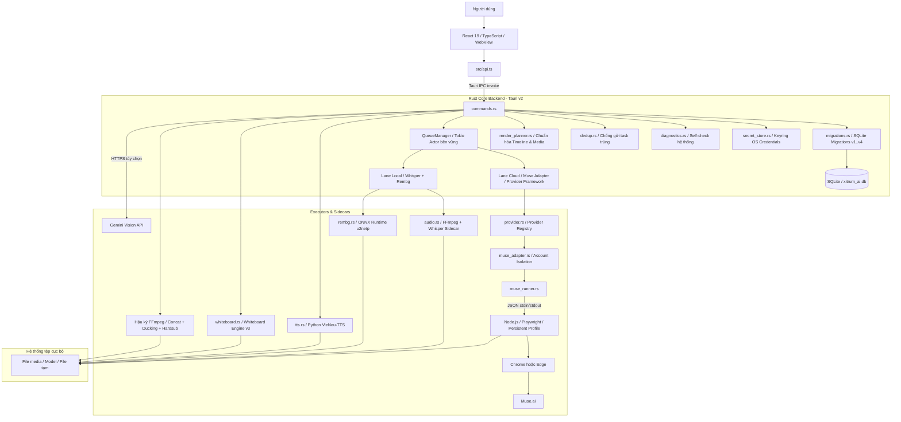
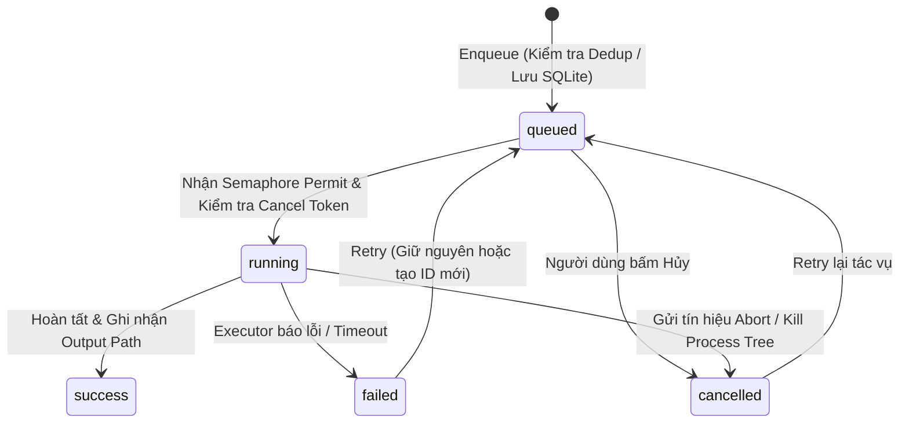

# Kiến trúc hệ thống Xitrum AI Studio

Tài liệu mô tả mã nguồn phiên bản **0.8.1**, đối chiếu ngày **09/11/2026**. Các hành vi dưới đây được xác định trực tiếp qua mã nguồn thực tế; không đồng nghĩa mọi tính năng đã được kiểm thử đầu cuối trên mọi hệ điều hành. Những khác biệt giữa mô tả trong README và triển khai thực tế được ghi chú minh bạch ở mục Giới hạn triển khai.

---

## 1. Mục đích và phạm vi

Xitrum AI Studio là ứng dụng desktop tạo và xử lý video, audio, ảnh tĩnh và hoạt họa vẽ tay bảng trắng. Người dùng thao tác trên giao diện React 19; backend Rust (Tauri v2) lưu trữ dữ liệu bền vững (SQLite với migrations có phiên bản), quản lý bí mật qua OS Keyring (DPAPI/Keychain/SecretService), điều phối hàng đợi tác vụ đa luồng (Multi-Lane Queue với deduplication và cancellation an toàn) và kết nối các engine chuyên biệt:

1. **Ý tưởng → Kịch bản → Video (Muse / Cloud Providers):** Chuẩn hóa prompt chatbot → nạp kịch bản JSON (làm sạch ký tự, BOM, smart quotes) → Character Bible & Product Catalog → gán khóa đặc trưng (Identity Lock / Product Lock / Environment Lock) → sinh giọng đọc VieNeu-TTS đa nhân vật → xuất hàng đợi điều phối Cloud Runner → hậu kỳ FFmpeg tự động (bù khung hình, ducking BGM, hardsub SRT).
2. **Audio → Video (Whisper STT Timeline):** Nhập file thu âm → FFmpeg chuẩn hóa PCM 16 kHz → Whisper nhận dạng phân tách câu chữ → AudioTimeline biên tập/duyệt từng phân đoạn → sinh clip tương ứng → ghép video với audio gốc.
3. **Prompt lẻ & Xóa nền tự động:** Sinh ảnh/video lẻ qua Muse context; xóa nền ảnh chân dung/sản phẩm bằng ONNX Runtime (`u2netp.onnx`) 100% offline trên máy.
4. **Whiteboard Studio (Hoạt hình bảng trắng vẽ tay - Nâng cấp v0.8.1):**
   - Phân tích phụ đề SRT độc lập hoặc nhập trọn gói kịch bản đồng bộ **Whiteboard Schema 3** (`<slug>.wb.json` & `<slug>.srt` có kiểm tra mã băm SHA-256 bảo đảm toàn vẹn).
   - **Đa giọng đọc đối thoại (Character Bible Whiteboard):** Tự động nhận diện nhãn nhân vật `[Tên]: Lời thoại`, phân vai từng giọng VieNeu-TTS riêng biệt, đọc nối tiếp trong cùng 1 cảnh mà không bị cắt vụn cảnh vẽ.
   - **Nạp ảnh hàng loạt (Batch Image Import):** Tự động quét thư mục khớp stem số nguyên (`1.png`, `02.jpg`...), hỗ trợ `.png`, `.jpg`, `.jpeg`, `.webp`, bảng chọn trùng/thiếu và nhận diện ảnh bìa `thumb.png`.
   - **Tạo mẫu nét vẽ hàng loạt (Batch Annotation Generation):** Tính toán timing tương đối theo từng cảnh, bảo toàn cảnh đã chỉnh sửa thủ công.
   - **Hệ thống Hand Rig Kinematics & Bút vẽ:** Xoay cổ tay tự nhiên theo vector vận tốc nét vẽ, thư viện đầu bút (Pencil, Marker, Fountain Pen, Calligraphy Brush).
   - **Bộ mã hóa trực tiếp (Direct FFmpeg Pipe Encoder):** Stream frame thô từ Python sang FFmpeg stdin, giảm thiểu IO đĩa, tối ưu tiến trình và tự động dọn dẹp cây tiến trình con khi bị hủy.
   - **Bộ tạo ảnh bìa Thumbnail thích ứng:** Xuất ảnh bìa 16:9 hoặc dọc 9:16 (TikTok, Reels, Shorts), chèn 2s đầu video có watermark/tiêu đề hoặc giữ nguyên bản thiết kế có sẵn.

---

## 2. Sơ đồ tổng thể



---

## 3. Bản đồ mã nguồn (Cập nhật v0.8.1)

| Đường dẫn | Vai trò kiến trúc |
| --- | --- |
| `src/main.tsx` | Mount ứng dụng React 19. |
| `src/App.tsx`, `src/App.css` | Shell giao diện, quản lý Sidebar, chuyển Tabs (Ý Tưởng, Bảng Trắng, Video Muse, Tài Khoản, Proxy, Audio, Timeline, Rembg, Templates, Settings), polling 1.500 ms và thông báo Toast. |
| `src/api.ts` | Kiểu dữ liệu TypeScript, wrapper IPC Tauri invoke, dialog picker native. |
| `src/components/IdeaScriptEditor.tsx` | Nhập JSON, Character Bible, Product Catalog, Prompt Locks, TTS phân vai, Dispatch Task Queue và Hậu kỳ FFmpeg. |
| `src/components/WhiteboardEditor.tsx` | Trình biên tập bảng trắng toàn diện: Visual Bounding Box Editor (Fabric.js), Timeline phân cảnh, Batch Image Import, Batch Annotation, Hand Rig Selector, Multi-Speaker Bible, Audio-driven timing preview, Render & Export video. |
| `src/components/WhiteboardProject.tsx` | Quản lý dự án Whiteboard: nạp/lưu project `.json`, metadata roundtrip, import WB Schema 3. |
| `src/components/AccountManager.tsx` | Quản lý danh sách tài khoản Cloud (Muse), trạng thái đăng nhập, hạn ngạch (quota) và phân lập thư mục profile trình duyệt. |
| `src/components/AudioTimeline.tsx` | Biên tập timeline câu chữ Whisper, duyệt/tạo lại clip từng đoạn, xuất SRT/TXT. |
| `src/components/ProxyManager.tsx` | Nhập, kiểm tra độ trễ (latency), đo IP ngoại, gán proxy vào tài khoản/runner. |
| `src/lib/whiteboardThumbnail.ts` | Trình tạo ảnh bìa Thumbnail thích ứng 16:9 và 9:16 bằng HTML5 Canvas/Fabric.js. |
| `src/lib/whiteboardFonts.ts` | Tải và đăng ký font chữ Việt hóa (Be Vietnam Pro, Montserrat, Playfair...). |
| `src/utils/whiteboardWbAdapter.ts` | Adapter chuyển đổi và đối chiếu cấu trúc kịch bản Whiteboard Schema 3 (`.wb.json`). |
| `src/types/whiteboard.ts` | Hệ thống định nghĩa kiểu dữ liệu kịch bản, phân cảnh, nét vẽ, speechConfig cho Whiteboard. |
| `src-tauri/src/main.rs`, `lib.rs` | Entry point Rust native, cấu hình tracing log rolling, plugin bootstrap và đăng ký IPC commands. |
| `src-tauri/src/state.rs` | AppState chứa `Arc<Database>`, `Arc<QueueManager>`, `Arc<WhiteboardPipeline>`. |
| `src-tauri/src/migrations.rs` | Hệ thống Migration SQLite có phiên bản (v1..v4), tự động nâng cấp schema an toàn không làm mất dữ liệu. |
| `src-tauri/src/secret_store.rs` | Lưu trữ mật khẩu/cookie an toàn qua OS Credential Manager (Keyring DPAPI / SecretService / Keychain), có fallback an toàn. |
| `src-tauri/src/dedup.rs` | Cơ chế Idempotency Key và phát hiện tác vụ trùng lặp trước khi đưa vào hàng đợi. |
| `src-tauri/src/paths.rs` | Chuẩn hóa đường dẫn hệ thống đa nền tảng (Windows / macOS / Linux), quản lý thư mục dữ liệu ứng dụng. |
| `src-tauri/src/diagnostics.rs` | Hệ thống tự kiểm tra (Self-check): binary FFmpeg, Whisper, Python, Node, GPU, quyền thư mục và môi trường chạy. |
| `src-tauri/src/render_planner.rs` | Bộ chuẩn hóa Media Timeline: tính toán timescale, xử lý drift phụ đề SRT, lập kế hoạch ghép nối video. |
| `src-tauri/src/commands.rs` | Điều phối toàn bộ IPC commands nghiệp vụ: task queue, project, audio, TTS, proxy, account, whiteboard và hậu kỳ. |
| `src-tauri/src/db.rs` | DAO truy vấn SQLite, quản lý giao dịch (transactions), liên kết task và trạng thái kịch bản. |
| `src-tauri/src/queue.rs` | Hàng đợi tác vụ Tokio actor bền vững: quản lý Semaphore, kiểm tra cờ hủy (cancellation token), khôi phục tác vụ khi khởi động lại. |
| `src-tauri/src/executors/provider.rs` | Khung trừu tượng hóa Provider Adapter: quản lý Capabilities, Session, Quota. |
| `src-tauri/src/executors/muse_adapter.rs` | Adapter kết nối Provider với MuseRunner và cô lập phiên tài khoản. |
| `src-tauri/src/executors/whiteboard.rs` | Quản lý tiến trình Python Whiteboard runner, giao tiếp JSON-RPC qua stdin/stdout, truyền nhận thông số batch và project export. |
| `sidecar-whiteboard/whiteboard_runner.py` | Router JSON-RPC xử lý các action: parse SRT, batch annotation, render scene, direct pipe encoder, project export, thumbnail generator. |
| `sidecar-whiteboard/scripts/` | Thư viện thuật toán xử lý ảnh, bóc tách contour, skeleton tracing, hand kinematics, audio-driven alignment, FFmpeg pipe wrapper. |

---

## 4. Khởi động và vòng đời ứng dụng

1. **Khởi tạo Runtime:** `lib.rs::run()` thiết lập hệ thống ghi log `tracing` ra stdout và rolling file `xitrum_debug.log`. Cấu hình plugin Tauri: shell, dialog, single-instance.
2. **Quản lý Đường dẫn & Cơ sở dữ liệu:** `paths::init()` xác định thư mục dữ liệu cục bộ theo hệ điều hành. Mở kết nối SQLite và kích hoạt `migrations::run_migrations(&conn)`:
   - **Migration v1:** Bảng `schema_migrations`, bảng `tasks` bổ sung `idempotency_key`, trạng thái khôi phục, retry counters.
   - **Migration v2:** Khởi tạo bảng `accounts` quản lý phân lập tài khoản và phiên trình duyệt.
   - **Migration v3:** Bảng `render_plans` và metadata timeline media.
   - **Migration v4:** Mở rộng cột hỗ trợ lưu trữ kịch bản Whiteboard Schema 3.
3. **Phục hồi hàng đợi khi khởi động (Crash Recovery):**
   - Các tác vụ bị treo ở trạng thái `running` do tắt app đột ngột được chuyển về `queued` (nếu có thể phục hồi) hoặc `failed` có giải thích rõ ràng.
   - Hàng đợi `QueueManager` nạp lại các task `queued` vào channel xử lý.
4. **Khởi tạo State dùng chung:** Tạo `Arc<Database>`, `Arc<QueueManager>` (khởi động 2 lane semaphore: Muse và Local), `Arc<WhiteboardPipeline>`.
5. **Giao diện người dùng:** React 19 mount, tải dữ liệu cấu hình, danh sách tài khoản, proxy và tiến trình hàng đợi; duy trì polling nhẹ nhàng 1.500 ms để cập nhật tiến độ.

---

## 5. Kiến trúc hàng đợi và thực thi tác vụ (Multi-Lane Queue)

Hàng đợi được thiết kế lại bền vững và an toàn hơn:



- **Chống gửi trùng (Deduplication - `dedup.rs`):** Tính toán hash `idempotency_key` từ loại tác vụ, prompt và tham số đầu vào. Nếu một tác vụ cùng nội dung đang ở trạng thái `queued` hoặc `running`, hệ thống trả về task ID hiện hữu thay vì tạo tác vụ trùng lặp.
- **Hủy tác vụ an toàn (Cancellation-Aware Execution):** Khi bấm hủy, task đổi sang `cancelled` trong database; Tokio Cancellation Token lập tức kích hoạt hủy tiến trình subprocess ở tầng sâu nhất (kể cả Playwright context lẫn cây tiến trình Python/FFmpeg), giải phóng ngay semaphore permit cho tác vụ kế tiếp.
- **Phân lập Lane độc lập:**
  - **Lane Cloud (Muse):** Giới hạn bởi `max_parallel_muse` và điều phối qua `provider.rs` & `muse_adapter.rs`. Hỗ trợ phân lập tài khoản qua `AccountManager`.
  - **Lane Local (Whisper, Rembg):** Xử lý tại máy cục bộ qua `max_parallel_local`, tận dụng CPU/GPU mà không làm nghẽn luồng Cloud.

---

## 6. Phân hệ Hoạt hình Bảng trắng (Whiteboard Studio Engine v3)

Từ phiên bản v0.8.0 và v0.8.1, Whiteboard Studio đã phát triển thành một hệ thống độc lập hoàn chỉnh với kiến trúc phân lớp sâu:

### 6.1. Hợp đồng dữ liệu & Kịch bản Whiteboard Schema 3
Hỗ trợ nhập kịch bản đồng bộ gồm cặp tệp `<slug>.wb.json` và `<slug>.srt`:
- **Nguyên tắc "1 Cảnh = 1 Ảnh vẽ":** Giữ nguyên cấu trúc cảnh gốc của kịch bản, dù cảnh có nhiều câu thoại đối thoại qua lại giữa các nhân vật vẫn dùng chung 1 bức ảnh minh họa và timeline liên tục.
- **Kiểm tra mã băm SHA-256:** Đối chiếu trực tiếp mã băm của file phụ đề SRT thực tế với metadata trong `.wb.json` để ngăn ngừa lỗi lệch phụ đề do chỉnh sửa ngoài.

### 6.2. Đa giọng đọc đối thoại (Multi-Speaker Character Bible)
- Tự động nhận diện nhãn nhân vật `[Tên nhân vật]: Lời thoại` trong file SRT (chuẩn hóa Unicode NFC).
- Cho phép gán từng nhân vật với một giọng đọc VieNeu-TTS độc lập (3 miền Bắc, Trung, Nam) và có giọng riêng cho Người dẫn chuyện (Narrator).
- Khi tạo audio, hệ thống tự động loại bỏ tiền tố nhãn nhân vật khỏi chuỗi phát âm để giọng đọc tự nhiên.

### 6.3. Nạp ảnh & Tạo mẫu nét vẽ hàng loạt (Batch Operations)
- **Batch Image Import:** Quét thư mục ảnh, tự động phân tích stem số nguyên (`1.png`, `02.jpg`...) để gán chính xác vào cảnh tương ứng. Cung cấp hộp thoại trực quan xử lý file trùng hoặc thiếu và tự động tách nhận diện ảnh bìa `thumb.png`.
- **Batch Annotation Generation:** Tự động sinh phân vùng và lộ trình ngòi bút cho toàn bộ kịch bản dựa trên thời lượng thoại thực tế của từng cảnh, có tùy chọn "Chỉ tạo mẫu còn thiếu" để bảo toàn các cảnh đã chỉnh sửa thủ công bằng Visual Editor.

### 6.4. Động học tay vẽ & Bộ mã hóa trực tiếp (Hand Kinematics & Direct Pipe Encoder)
- **Hand Rig Kinematics:** Cổ tay và ngòi bút xoay linh hoạt theo vector vận tốc của nét vẽ (sử dụng ma trận xoay góc $\theta = \operatorname{atan2}(v_y, v_x)$), mang lại cảm giác vẽ tay chân thực.
- **Thư viện đầu bút:** Hỗ trợ 4 loại ngòi bút chuyên biệt: *Pencil* (bút chì), *Marker* (bút dạ), *Fountain Pen* (bút máy) và *Calligraphy Brush* (bút lông thư pháp).
- **Direct FFmpeg Pipe Encoder:** Khung hình render từ OpenCV/NumPy được pipe trực tiếp qua `stdin` của tiến trình FFmpeg, loại bỏ việc ghi hàng ngàn file frame trung gian ra ổ cứng, tăng tốc độ xuất video và tiết kiệm dung lượng đĩa.

---

## 7. Khung Provider và Quản lý Tài khoản (Account Isolation)

Kiến trúc Provider trừu tượng hóa kết nối với các dịch vụ tạo video AI:

- **Provider Trait (`provider.rs`):** Định nghĩa giao diện chuẩn cho việc kiểm tra phiên (`check_session`), tạo video (`generate_video`), truy vấn trạng thái và kiểm tra hạn ngạch (`quota`).
- **Account Isolation (`AccountManager.tsx` & `db.rs`):** Mỗi tài khoản có thư mục Persistent Browser Profile riêng biệt (ví dụ `profiles/<account_id>`), cho phép người dùng đăng nhập nhiều tài khoản Muse hoặc các dịch vụ khác nhau mà không bị xung đột cookie hay phiên làm việc.
- **Lưu trữ bảo mật (`secret_store.rs`):** Mật khẩu tài khoản và API Token được ủy quyền lưu trữ cho OS Credential Store (Windows DPAPI Credential Manager, macOS Keychain, Linux SecretService) thay vì lưu plain text hay mã hóa XOR thô sơ.

---

## 8. Cấu hình, Lưu trữ và Mạng

| Hạng mục | Cơ chế lưu trữ & Xử lý |
| --- | --- |
| **Cơ sở dữ liệu** | `app_local_data_dir()/xitrum_ai.db`, quản lý bởi SQLite migration v1..v4. |
| **Bí mật & Token** | Hệ thống Keyring OS (`secret_store.rs`); fallback bộ nhớ tạm an toàn nếu hệ thống từ chối quyền. |
| **Thư mục xuất Media** | Mặc định `XitrumAI_Outputs` tại thư mục Videos của người dùng, có thể cấu hình linh hoạt. |
| **Profiles trình duyệt** | `data_local_dir()/XitrumAI/profiles/<account_id>`, hỗ trợ chạy song song độc lập. |
| **Bộ mã hóa & AI Models** | FFmpeg và Whisper-cli sidecars theo kiến trúc bundle của Tauri; model Whisper và ONNX `u2netp.onnx` nạp từ resources hoặc data local. |
| **Mạng & Proxy** | Proxy được gán trực tiếp vào từng context trình duyệt Playwright hoặc HTTP client Rust khi test kết nối. |

---

## 9. Giới hạn triển khai cần lưu ý

1. **Phụ thuộc môi trường Python cục bộ:** Mặc dù Whiteboard Engine và VieNeu-TTS chạy offline 100%, máy tính người dùng cần cài sẵn Python 3.10+ (có `py.exe` trên Windows hoặc `python3` trên macOS/Linux) cùng các thư viện trong `requirements.txt` (`opencv-python`, `pillow`, `numpy`, `av`, `vieneu`).
2. **Cloud Automation DOM Fragility:** Engine Muse phụ thuộc vào tính ổn định của DOM giao diện web Muse.ai. Khi giao diện web thay đổi, cần cập nhật file cấu hình `selectors.default.json`.
3. **Thư viện Fabric.js trên Frontend:** Trình vẽ trực quan Bounding Box yêu cầu gói npm `fabric` được cài đặt đầy đủ trong `node_modules` của frontend.
4. **Kiểm tra mã băm SRT:** Cơ chế kiểm tra SHA-256 của WB Schema 3 yêu cầu tệp SRT không bị chỉnh sửa dấu xuống dòng (CRLF/LF) từ các trình soạn thảo bên ngoài làm thay đổi byte raw.

---

## 10. Hướng dẫn kiểm thử và phát triển mở rộng

- **Kiểm tra Frontend:**
  ```bash
  npm run build
  ```
- **Kiểm tra Backend Rust:**
  ```bash
  cargo check
  ```
- **Kiểm tra Whiteboard Python Runner (Smoke test):**
  ```bash
  py sidecar-whiteboard/tests/test_runner_smoke.py
  ```
- **Kiểm tra Import & Timing Roundtrip:**
  ```bash
  py -m unittest sidecar-whiteboard/tests/test_wb_import.py
  py -m unittest sidecar-whiteboard/tests/test_wb_import_roundtrip.py
  ```
