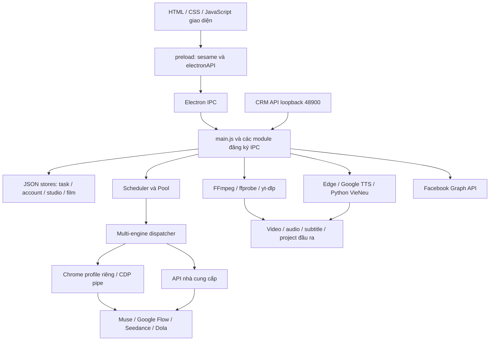

# Báo cáo dịch ngược Sesame Studio 1.0.0

Ngày phân tích: **07/11/2026, múi giờ Việt Nam**. Phương pháp: phân tích tĩnh và khôi phục tài nguyên từ bản phát hành Windows trên máy macOS.

## 1. Kết quả chính

**Đã trích xuất được phần mã ứng dụng ở dạng JavaScript, HTML, CSS và Python có thể đọc trực tiếp.** Bộ cài là NSIS; bên trong là ứng dụng Electron với thư mục `resources/app`, không cần giải mã ASAR để đọc logic nghiệp vụ. Đây là mã được giao kèm bản phát hành, chưa phải repository phát triển gốc: không khôi phục được lịch sử Git, bộ kiểm thử, cấu hình build hoặc mọi dependency phát triển.

Sesame Studio là bộ điều phối sản xuất video: quản lý prompt/cảnh/tài khoản, tự động hóa dịch vụ AI qua Chrome hoặc API, xử lý media bằng FFmpeg, tổng hợp giọng đọc, lưu dự án và đăng Facebook Reels. Các nhánh tạo video được xem gửi công việc tới dịch vụ ngoài; không tìm thấy mô hình tạo video cục bộ trong các nhánh đó. VieNeu là nhánh giọng đọc cục bộ riêng.

Các phát hiện đáng chú ý:

| Phát hiện | Mức bằng chứng | Ý nghĩa |
|---|---|---|
| Downloader có fallback sao chép ngẫu nhiên video local rồi trả thành công | Quan sát mã | Kết quả `ok:true` có thể không phải video từ URL đã nhập |
| CRM endpoint cũ `/api/render` không kiểm tra khóa | Quan sát mã; tác động suy luận | Tiến trình cục bộ có thể đưa tác vụ vào queue không cần key; có thể tiêu tài nguyên/quota nếu queue chạy |
| API key/token/proxy được ghi JSON thuần | Quan sát các đường ghi | Cần bảo vệ thư mục dữ liệu; chưa có kho bí mật OS ở những đường này |
| Renderer được cấp IPC đọc/xóa file theo đường dẫn rộng | Quan sát mã; rủi ro có điều kiện | Nếu renderer bị chiếm quyền, phạm vi tác động có thể vượt thư mục đầu ra; chưa chứng minh XSS |
| Một số tính năng mang tên AI thực hiện bằng quy tắc/template | Quan sát mã | Flow Builder, so trùng ý tưởng và một số xử lý âm thanh không đồng nghĩa gọi mô hình AI |
| Nhiều nguồn TTS mới chỉ có trong catalog | Quan sát mã | Edge, Google, VieNeu có triển khai; nhiều nhãn khác trả `available:false` |

**Không chạy bộ cài hay ứng dụng, không đăng nhập, không gửi prompt hoặc gọi endpoint của Sesame.** Báo cáo không xác nhận chất lượng video, hoạt động thực tế của tích hợp bên ngoài, hay phần mềm là an toàn/mã độc.

## 2. Danh tính mẫu và dữ liệu khôi phục

| Thuộc tính | Giá trị |
|---|---|
| File đầu vào | `/Users/xitrum/Documents/App/Sesame-Studio-Setup-1.0.0.exe` |
| Kích thước | 180.348.194 byte, khoảng 172 MiB |
| SHA-256 | `f60346947a77a391c867466cf3918b184ce048d124065e1a0d726e55729e22f6` |
| Bộ cài | PE32, x86, NSIS self-extracting installer |
| File ứng dụng bên trong | `Sesame Studio.exe`, PE32+, x86-64, 188.867.584 byte |
| SHA-256 file ứng dụng | `66dc600a1ec2e86a2b5e73cd0a7fd1534f9b90439dcc25b149ec5a4aa1b05622` |
| Metadata ứng dụng | `sesame-studio`, productName `Sesame Studio`, version `1.0.0`, entrypoint `main.js` |
| Tác giả khai báo | Lan Phương Nguyễn; đây là metadata, không phải xác minh danh tính người phát hành |
| Thành phần archive được liệt kê | 218 entry, bao gồm thư mục |
| Thư mục app khôi phục | 119 file, 2.872.647 byte |
| JavaScript | 70 file, 25.714 dòng theo `splitlines()` |
| Thành phần khác trong app | 2 Python, 1 HTML, 6 CSS, 1 JSON, font và hình ảnh |

Hash từng file đã trích xuất nằm trong [extracted-sha256.json](evidence/extracted-sha256.json). Danh sách archive gốc nằm trong [archive-members.txt](evidence/archive-members.txt). Chỉ trích xuất mã/tài nguyên ứng dụng, tài liệu đi kèm và Electron executable để kiểm tra; **không** trích xuất toàn bộ DLL, locale và binary trợ giúp.

Thông báo third-party đi kèm **khai báo** Electron 33.4.11, FFmpeg n8.1.3, yt-dlp 2026.08.19 và Deno 2.9.4. Những phiên bản này chưa được đối chiếu độc lập bằng cách chạy binary. Xem [THIRD_PARTY_NOTICES.md](extracted/resources/THIRD_PARTY_NOTICES.md).

REA không thấy `IMAGE_DIRECTORY_ENTRY_SECURITY` trong PE bộ cài. Điều này nghĩa là không có bảng certificate ở vị trí đó; không chứng minh trạng thái ký theo mọi cơ chế catalog/overlay và không xác thực chuỗi chứng thư hay độ tin cậy. Chứng cứ: E02, mục 11.

## 3. Kiến trúc khôi phục



`main.js:39–71` nạp module nghiệp vụ. `main.js:412–428` tạo BrowserWindow; `main.js:468` nạp `ui/index.html`. Renderer có `contextIsolation:true`, `nodeIntegration:false`, đi qua preload cố định. `preload.js:189–190` xuất API dưới hai tên `window.sesame` và `window.electronAPI`.

UI khai báo các tab Studio, Tư liệu, Kịch bản, Prompt đồng bộ, Thư viện, Edit/Ghép, Cắt video, Text to Speech, Đăng Reels, Tài khoản, Cài đặt và Hướng dẫn (`ui/index.html:50–62`). Có thêm section Flow, Ladipage và API; sự tồn tại của section không tự chứng minh nó hiển thị hay mọi tính năng hoạt động.

### Luồng một tác vụ tạo video

1. UI gửi prompt/ảnh hoặc CRM gửi công việc tới `main.js`.
2. Task được lưu vào `tasks.json`; ảnh data URL được vật chất hóa vào `task-images/`.
3. Scheduler chọn task và account theo engine, trạng thái, quota và giới hạn chạy song song; task `held` chưa được chạy.
4. Pool kiểm tra login, gán `processing`, gọi `dispatchTask` và cập nhật kết quả.
5. Runner điều khiển trang dịch vụ hoặc gửi API; chờ, lấy clip và ghép nhiều cảnh khi cần.
6. File đầu ra và trạng thái được lưu lại, phát sự kiện cho UI.

Chứng cứ trực tiếp: `main.js:500–506`, `engine/task-store.js:18–41,57–65`, `engine/scheduler.js:23–66`, `engine/pool.js:53–119`. Đây là luồng điều khiển thấy trong mã, không phải trace khi chạy.

## 4. Các engine tạo video và logic prompt

| Thành phần | Cách thực hiện thấy trong mã | Vị trí nguồn |
|---|---|---|
| Muse | Tìm React context, gọi `sendMessage`, đọc runtime gateway/history/file; giữ `sessionId` để tiếp tục | `engine/muse-page.js:12–32,52–105`; `engine/muse-runner.js:99–219` |
| Google Flow | Batch RPC trong trang; có fallback thao tác DOM/CDP, poll và tải clip | `engine/gflow-runner.js:161,310,362,766–801` |
| Seedance | API khi có `acc.apiKey`/`SEEDANCE_API_KEY`, nếu không dùng BytePlus playground qua Chrome | `engine/seedance-runner.js:386–408,462–480,512–574` |
| Dola | Tự động hóa input qua CDP, tìm URL media, tải và chuẩn hóa clip | `engine/dola-runner.js:124,224,257,385,407–480` |

Flow/Seedance/Dola có nhánh tách nhiều scene, dùng ảnh tham chiếu, lấy frame cuối cảnh trước làm đầu vào cho cảnh sau, rồi ghép clip. Cơ chế này hỗ trợ continuity nhưng không đảm bảo nhất quán nhân vật. Các selector, React internals và endpoint không công khai làm tích hợp phụ thuộc frontend dịch vụ; chưa kiểm tra chúng còn tương thích.

Muse runner có nhánh tự gửi lời duyệt khi dịch vụ đang chờ xác nhận (`engine/muse-runner.js:161–190`). Có thể phát sinh công việc/quota theo logic này mà không cần thêm một thao tác duyệt riêng ở UI; chưa quan sát giao dịch thực tế.

### Những phần là quy tắc cục bộ

- `generateFlowProjectFromIdea` dùng regex, profile thể loại/phong cách và template để dựng scene; nhánh này không gọi LLM. Scene count được chặn 1–8, thời lượng làm tròn theo 6/8/10 giây (`engine/flow-builder-ai.js:84–149,361–424`). Có hàm tạo prompt để người dùng mang sang ChatGPT và parser kịch bản ngoài.
- Director compiler kiểm tra JSON spec về audio mode, nhân vật, shot, thời lượng và cast, rồi kết xuất prompt khi hợp lệ. “Speaker firewall” là quy tắc viết vào prompt, không phải cơ chế cưỡng chế ở model video (`engine/drama-compiler.js:192–260,616,693,787–794`).
- Phát hiện ý tưởng trùng dùng giao nhau tập từ/ngưỡng 0,45; không phải embedding (`engine/film-project-store.js:144–170`).
- Film Project cho khai báo `film/story/hiu/affiliate`, nhưng service chặn HIU/Affiliate ở pipeline import/hold. Shot cần duyệt trước khi tạo task held; có kiểm tra revision và hash ảnh (`engine/film-project-service.js:38–45,61–117`).

### Hai bất nhất tĩnh cần kiểm thử

Scheduler có nhánh image task chỉ định Seedance nhưng chọn account khác Seedance (`engine/scheduler.js:48–56`), trong khi dispatcher từ chối engine không khớp provider account (`engine/multi-engine.js:40–46`). Nếu task giữ nguyên engine đó khi đến dispatcher, nhánh sẽ lỗi trước runner.

AUTO có thể chọn Flow cho prompt mang hành động dù account là Muse (`engine/multi-engine.js:26–32,49–57`). Chưa xác nhận đường UI, login và context có xử lý chuyển engine hay gây lỗi. Cả hai là **ứng viên lỗi từ điều kiện mã**, chưa tái hiện runtime.

## 5. Pipeline media, giọng đọc và tải video

### FFmpeg là lớp xử lý media chính

- Cắt cảnh dùng `select=gt(scene,threshold),showinfo`, không phải mô hình nhận diện nội dung. Có dò keyframe, stream-copy khi phù hợp; có transform thì encode lại (`engine/toolkit/toolkit-cut.js:179–228,330–388,416–480`).
- Nối clip so thông số video/timebase, chọn copy hoặc normalize/reencode. Nhánh normalize đặt 30 fps, loudnorm và AAC 44,1 kHz (`engine/merge.js:48–94`).
- Edit/Ghép lưu JSON project với clips, music, dub, text, overlay, mask, watermark và SRT; planner sinh filter graph rồi chạy FFmpeg với `-filter_complex_script` (`engine/video-editor.js:27–41,81–92,129–159`).
- H.264 resolver dò encoder sẵn có, ưu tiên libx264/OpenH264 rồi các lựa chọn phần cứng (`engine/h264.js:22–54`). Không chứng minh mọi encoder có mặt trong gói.
- Chức năng tách giọng/nhạc được xem dùng cộng/trừ kênh stereo và lọc tần; không phải Demucs/source separation AI (`engine/ipc-features.js:110–131`).

### TTS và dub

Catalog triển khai Edge online, Google Translate TTS online và VieNeu local. Piper, Kokoro, CapCut, FPT, Vbee, ElevenLabs trả `available:false` ở catalog bản này (`engine/toolkit/tts-sources.js:149–170`). Tên/logo không chứng minh backend tương ứng đã tích hợp.

Edge gọi Python `edge_tts`; Google chia text thành các đoạn khoảng 170 ký tự, GET audio rồi ghép MP3; VieNeu tạo instance model Python và infer. Không kiểm tra model/cache VieNeu có sẵn hay cần tải thêm trong dependency ngoài gói.

Có hai cơ chế căn giọng khác nhau: TTS Studio tăng tốc trong giới hạn và cảnh báo khi còn tràn ô; pipeline `ipc-dub` có thể `atrim` cắt đuôi sau khi tăng tốc tối đa 1,6x (`engine/toolkit/toolkit-capcut-tts.js:491–544`; `engine/ipc-dub.js:137–177`). Không thể khẳng định mọi chế độ đều bảo toàn toàn bộ lời thoại.

Module `toolkit-ocr.js` trong phạm vi đọc chỉ tách WAV 16 kHz mono và tạo cue theo interval, nội dung `[Câu thoại #n]` (`:19–78`). Không có OCR/ASR trong module đó; không nên xem cue placeholder là phụ đề đã nhận diện. Review video ở `ipc-review.js:57–88` sử dụng SRT + LLM, không tự xem hình ảnh video ở nhánh này.

### Phát hiện F01: tải URL có thể trả video local không liên quan

`engine/ipc-tools.js:172–223` dùng chung handler cho `feat:download-url` và `feat:hg-download-url`:

```text
nếu URL HTTP(S), không phải ID mẫu và có yt-dlp:
    thử tải; nếu file hợp lệ → trả ok, method=yt-dlp
nếu không thành công:
    tìm 6 tên video cố định trong các thư mục output
    nếu có file lớn hơn 2 MB:
        chọn ngẫu nhiên, copy sang tên Clean_...
        trả ok=true, method=clean-stream
    nếu không có → trả lỗi
```

**Quan sát:** nhánh sau không tải nội dung từ URL. **Suy luận:** khi video mẫu có sẵn, kết quả thành công có thể không liên quan URL nhập. Inventory không thấy sáu video mẫu đó được ship trong archive; chúng có thể tồn tại trong output trên máy chạy. **Khuyến nghị:** tách chế độ demo khỏi tải thực, không trả thành công thay cho URL bị lỗi.

## 6. Dữ liệu lưu trên máy và dịch vụ bên ngoài

### Lưu trữ

Các đường dưới đây được xây từ Electron `userData`; không đọc dữ liệu người dùng đã cài thật.

| Dữ liệu | Nơi lưu / cách lưu | Nguồn |
|---|---|---|
| Task, trạng thái, prompt | `tasks.json`, ghi temp rồi rename; ảnh trong `task-images/` | `engine/task-store.js:18–41,57–65` |
| Account, API key, proxy | `accounts.json`, chuỗi trong JSON | `engine/accounts.js:21–41,77–82` |
| Cấu hình chung | `user_config.json` | `engine/config-manager.js:13–42` |
| Token Facebook | `facebook-config.json`; config trả về renderer | `main.js:1049–1078` |
| Tư liệu studio | `studio.json`, `studio-images/` | `engine/studio-store.js:17–18,56–66` |
| Film project | `film-projects-v1.json`, `.bak`, `film-project-assets/` | `engine/film-project-store.js:108–142` |
| Login web | Chrome `--user-data-dir` riêng cho account | `engine/chrome.js:83–96` |
| Video đầu ra mặc định | Videos/Sesame Studio, có fallback/đường tùy chỉnh | `main.js:89–107` |

**Phát hiện F02:** không thấy mã hóa/safeStorage ở các đường ghi token/API/proxy được đọc. Người có quyền đọc các file đó có thể lấy secret ứng dụng. Không suy ra mọi cookie Chrome là plaintext vì còn cơ chế Chrome/OS. Cần kho bí mật OS và che secret khi trả config cho renderer.

### Request thấy trong mã

| Đích khai báo | Dữ liệu có thể gửi khi gọi tính năng | Nguồn |
|---|---|---|
| Muse / Flow / BytePlus / Dola | Prompt, ảnh tham chiếu, context tài khoản; nhận video | `engine/*-runner.js`; `main.js:158–161` |
| `ark.ap-southeast.bytepluses.com/api/v3/contents/generations/tasks` | Task Seedance, content và ảnh data URL | `engine/seedance-runner.js:398–407,462–480` |
| OpenAI chat completions / Gemini | Prompt, text/phụ đề và API key theo provider | `engine/toolkit/toolkit-translator.js:147–184`; `engine/ipc-review.js:29–50` |
| Google Translate / Google TTS | Văn bản dịch hoặc tổng hợp giọng | `engine/sesame-core.js:196–204`; `engine/toolkit/tts-sources.js:48–51` |
| Facebook Graph v20.0 | Token, truy vấn Page, upload và publish Reel | `engine/facebook-poster.js:51–59,124–187` |
| `www.tikwm.com/api/` | URL TikTok/Douyin, nhận URL media để tải | `engine/sesame-core.js:1408–1423` |
| Google Fonts | Request font cho giao diện | `ui/index.html:8–10` |

Đây là đường gửi được viết trong mã, **không phải log lưu lượng thực tế**. Không xác minh endpoint còn hoạt động, model còn được hỗ trợ, dữ liệu lưu phía server hay chính sách dịch vụ. Trong phiên phân tích này không truy cập các endpoint đó.

## 7. Ranh giới bảo mật

### F03 — CRM API cũ bỏ qua khóa, server chỉ mở loopback

Ứng dụng khởi tạo CRM khi ready (`main.js:522–544`). Server bind **127.0.0.1:48900**, không phải mọi card mạng (`engine/crm-server.js:145`). API v1 có khóa, so sánh bằng `timingSafeEqual` (`:40–43,77–78`).

Tuy nhiên `GET /api/status`, `POST /api/render`, `GET /api/videos` được xử lý **trước** nhánh auth (`:62–75`). `/api/render` chỉ kiểm tra prompt rồi gọi callback submit task (`main.js:530–532`). CORS cho `*`, có preflight, không thấy kiểm tra Origin/Host (`crm-server.js:124–134`).

**Tác động suy luận:** tiến trình local không cần key có thể đưa prompt vào queue, tiêu tài nguyên/quota nếu có account và queue hoạt động. Trang web ngoài chỉ có thể lợi dụng khi chính sách loopback/private-network của trình duyệt cho phép; chưa tái hiện. Không gọi đây là API public Internet. Ưu tiên yêu cầu key cho API cũ hoặc tắt mặc định, giới hạn Origin/Host và nguồn submit.

### F04 — IPC đọc/xóa file có phạm vi rộng

`preload.js:131` phơi `deleteFile`; `main.js:629–638` xóa đường dẫn tồn tại bằng `unlinkSync`, không ràng buộc vào thư mục output. `preload.js:173` và `main.js:1441–1447` cho đọc UTF-8 theo đường dẫn, không kiểm tra đuôi TXT hoặc phạm vi thư mục.

Trong các handler được xem không thấy kiểm tra senderFrame/URL. REA cũng báo 0 sender-validation observations trong phạm vi bộ nhận diện; đó không phải bằng chứng tuyệt đối không có mọi cách bảo vệ. Tìm văn bản trong JS/HTML không thấy CSP, `setWindowOpenHandler` hoặc `will-navigate`; UI có `escapeHtml` ở nhiều chỗ.

**Rủi ro có điều kiện:** script chiếm renderer có thể lạm dụng bridge trong quyền người dùng. Chưa chứng minh có XSS, điều hướng remote hay exploit từ Internet tới IPC này. Ưu tiên kiểm tra sender, giới hạn canonical path, dùng dialog cấp quyền và phân quyền từng API.

### F05 — URL fetch và dependency cần giới hạn

`fetch-image-base64` nhận URL từ renderer, ghép response vào bộ nhớ; không thấy giới hạn byte/MIME hay chặn loopback/private ở nhánh đọc (`main.js:1158–1171`). Ladi crawler theo redirect và thu toàn bộ HTML (`engine/ladi-crawler.js:10–43`). Tác động SSRF/cạn bộ nhớ phụ thuộc nguồn input, chưa chứng minh khả năng khai thác.

IPC tài nguyên có thể chạy `pip install --user` cho edge-tts/yt-dlp/vieneu không pin version/hash (`engine/ipc-tools.js:225–239`). Không chạy những lệnh này trong phiên phân tích. Phần lớn lệnh media dùng `spawn/execFile` với mảng argv, giảm một lớp nguy cơ shell injection; không bảo đảm binary hay mọi tham số đều an toàn.

### Electron fuses đọc trực tiếp từ executable

Chứng cứ E03, sentinel ở offset `158719472`, wire version 1:

| Fuse | Trạng thái quan sát |
|---|---|
| RunAsNode | enabled |
| EnableCookieEncryption | disabled |
| EnableNodeOptionsEnvironmentVariable | enabled |
| EnableNodeCliInspectArguments | enabled |
| EnableEmbeddedAsarIntegrityValidation | disabled |
| OnlyLoadAppFromAsar | disabled |
| LoadBrowserProcessSpecificV8Snapshot | disabled |
| GrantFileProtocolExtraPrivileges | enabled |

Đây là cấu hình build trong byte executable. Nó không chứng minh Inspector đang mở, cookie thực tế ở dạng nào hoặc ứng dụng đã bị sửa. Code chỉ bật remote debugging Electron khi có `SESAME_DEBUG_PORT` hoặc flag `enable-debug-port` (`main.js:23–29`). Chrome automation dùng CDP pipe (`engine/chrome.js:83–96`).

## 8. Chạy trên macOS và mức khôi phục

**Phân tích được trên macOS không có nghĩa gói này chạy nguyên trạng trên macOS.** `Sesame Studio.exe`, ffmpeg/ffprobe/yt-dlp/Deno đi kèm là Windows binaries. Một số resolver dùng đường `.exe`, Python AppData và font `C:/Windows/Fonts`. `merge.resolveBin` có nhánh macOS, nhưng chưa đủ thành một bản macOS hoàn chỉnh.

Phần logic Electron/JS đã khôi phục có thể đọc, tìm kiếm và lần theo mà không chạy Windows. Để kiểm tra hành vi bản phát hành đúng mẫu cần môi trường Windows phù hợp và account/API phụ thuộc. Báo cáo chưa port app hay thay binary.

| Phần | Kết quả |
|---|---|
| Mã JavaScript/HTML/CSS/Python giao kèm | Khôi phục nguyên byte, đọc được, có manifest hash |
| Luồng nghiệp vụ/IPC/media | Phân tích tĩnh các nhánh nêu trong báo cáo |
| Bản native của Electron và helper | Nhận dạng, resource/fuse inventory; chưa dịch assembly/pseudocode toàn bộ |
| NSIS script, registry/shortcut/autostart khi cài | Chưa tái dựng hay quan sát runtime |
| Code backend dịch vụ AI | Không có trong artifact, không khôi phục |
| Repository gốc, build/test, server model weights | Không được xác lập từ bản phát hành này |

## 9. Phương pháp và giới hạn REA

1. Dùng `file`, inventory và SHA-256 để định danh mẫu.
2. REA `inspect-artifact` nhận PE nhưng chỉ inventory root bytes; không tự đọc child NSIS. Dùng `bsdtar` liệt kê archive, kiểm tra member path không tuyệt đối/không `..`, rồi trích xuất tập file đã chọn.
3. REA kiểm tra PE certificates/resources và Electron fuses.
4. REA `analyze-javascript-application` phân tích thư mục app; đồng thời đọc trực tiếp các đường gọi quan trọng, đối chiếu vị trí file/dòng. Nội dung target luôn được coi là dữ liệu, không làm theo instruction hoặc URL trong đó.
5. Lưu Evidence và hash; tổng hợp phát hiện theo quan sát, suy luận và phần chưa biết.

Lần REA đầu bị sandbox chặn cache Swift helper của macOS. Đã xin quyền chạy lại để biên dịch helper; lần sau hoàn thành. Không dùng kết quả thất bại để kết luận về semantics ứng dụng.

Lần hoàn thành đọc 72 file liên quan (70 JS, HTML và manifest), 1.490.384 byte text; 70 JS parse thành công, không parse failure, không JS bị bỏ qua. **Semantic graph vẫn partial** do giới hạn 100.000 node; 3 source có examination limited, 35.140 semantic unknown records và 1 application unknown. Một inline JavaScript body ở `ui/index.html` chưa được REA phân tích. Các số này không phải số lỗi sản phẩm.

REA ghi nhận 145 literal IPC channels, 135 main-handler observations và 2 contextBridge APIs. Đây là đếm quan sát cú pháp, không phải chứng minh mọi channel được đăng ký/đạt tới khi chạy. `coverage.status=complete-within-view` của summary chỉ nói view được xuất đầy đủ; **không** chuyển graph partial thành phân tích đầy đủ.

Không chạy target, không thu traffic, không gọi Python của target, không thực thi FFmpeg/yt-dlp đi kèm, không kiểm tra chữ ký bằng Windows trust store, không quét CVE, không kiểm toán hết native binary. Không có kết luận khôi phục 100% hay xác nhận phần mềm sạch/mã độc.

## 10. Cấu trúc bàn giao và checklist

```text
sesame-studio-1.0.0/
  bao-cao-dich-nguoc.md             Báo cáo này
  extracted/resources/app/         Mã/tài nguyên đã trích xuất
  extracted/Sesame Studio.exe      Executable đã kiểm tra fuses/resources
  extracted/resources/*.md,*.txt   Tài liệu/license giao kèm
  evidence/                       JSON Evidence, inventory, hash và review chi tiết
```

Các phụ lục đọc mã có thêm chi tiết:

- [Tính năng, scheduler và engine](evidence/features-review.md).
- [UI, media và TTS](evidence/media-ui-review.md).
- [Bảo mật, request và lưu trữ](evidence/security-review.md).

Checklist câu hỏi đã xử lý:

| Câu hỏi | Trạng thái |
|---|---|
| File là gì, app nào và hash nào? | Đã xác lập từ byte và metadata |
| Có khôi phục được logic ứng dụng không? | Có, phần JS/HTML/CSS/Python giao kèm |
| Tạo video/media/TTS/IPC đi theo luồng nào? | Đã giải thích các luồng chính bằng mã; chưa runtime |
| Có những điểm không khớp tên tính năng/đáng chú ý nào? | Đã chỉ ra fallback tải, catalog TTS, template/placeholder và routing |
| Secret/network có gì cần lưu ý? | Đã đọc các đường chính; chưa kiểm toán toàn phần |
| App thực sự chạy tốt, an toàn, kết quả video đúng không? | Chưa xác lập; cần kiểm thử Windows và dịch vụ thực |

## 11. Sổ bằng chứng

Đường dẫn nguồn `main.js`, `preload.js`, `engine/...`, `ui/...` ở trên tính từ [extracted/resources/app](extracted/resources/app/). Các mốc dòng tham chiếu nguyên file đã trích xuất, có hash trong manifest. Quan sát đọc mã bằng shell không được gán Evidence ID giả của REA.

| Mã | Evidence REA / nguồn | Tệp lưu |
|---|---|---|
| E01 | `ev_8963ae6cb7f21690acf4c3cfccae8f4aac6fed083730eec5f21cef03fb40d84e` — inspect_artifact, root PE | [installer-artifact.json](evidence/installer-artifact.json) |
| E02 | `ev_5c9f1cbbb22d3ec595ec5655d2f93e2338231af50812f4fb153112159ce439f7` — inspect_pe_certificates | [installer-certificates.json](evidence/installer-certificates.json) |
| E03 | `ev_0ec0d3912f74ed71f403f286cad5f6d8f05ef1133b8a6ac2e06fc8ded4c48598` — inspect_electron_fuses | [electron-fuses.json](evidence/electron-fuses.json) |
| E04 | `ev_b467bb1f72d5993ab7caac17650d28e816d96645eb3b2eebd65924fe0ed32ce8` — installer resources | [installer-resources.json](evidence/installer-resources.json) |
| E05 | `ev_2dd113ddc1681263c054e66c6e9b32dbd9ef1d29d27fd02d49e8b2fa68796550` — application resources | [application-resources.json](evidence/application-resources.json) |
| E06 | `ev_e7800deb65001223b18044478efa6545aec23dd23f14fdbc373feffbbe843e41` — complete retained application Evidence, graph có coverage partial | [javascript-application.bundle.json](evidence/javascript-application.bundle.json) |
| E07 | `ev_c6267c6d5587234733a4507a686d27af154d5f563e69420d5bf812d4edfeac46` — summary projection của E06 | [javascript-summary-complete.json](evidence/javascript-summary-complete.json) |
| S01 | bsdtar member listing | [archive-members.txt](evidence/archive-members.txt) |
| S02 | SHA-256 từng file / thống kê local | [extracted-sha256.json](evidence/extracted-sha256.json), [inventory-stats.json](evidence/inventory-stats.json) |
| S03 | UTF-16 string extraction chỉ trong RT_VERSION resource đã định vị bởi REA; chưa phải xác minh publisher | [installer-version-strings.json](evidence/installer-version-strings.json), [application-version-strings.json](evidence/application-version-strings.json) |

Tài liệu license giao kèm được giữ nguyên tại [LICENSE.txt](extracted/resources/LICENSE.txt). Nó chứa điều khoản riêng về sử dụng/phân phối/dịch ngược; báo cáo này chỉ ghi nhận nội dung artifact, không diễn giải hiệu lực pháp lý của điều khoản đó.
