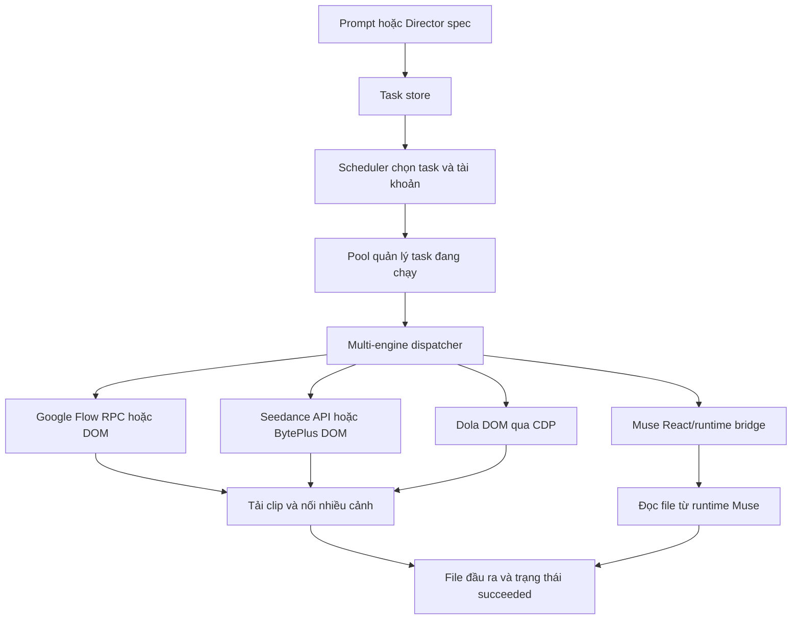

# Phân tích tính năng và engine — Sesame Studio 1.0.0

Phạm vi: đọc tĩnh mã JavaScript đã trích xuất từ bộ cài; không chạy ứng dụng, không đăng nhập, không gửi prompt và không kiểm tra endpoint trực tuyến. Đường dẫn bên dưới tính từ `extracted/resources/app/`. Đây là chứng cứ đọc mã thông thường, không phải Evidence ID do REA sinh.

## Kiến trúc luồng tác vụ

**Quan sát:** `main.js:500-506` khởi tạo `Pool` và truyền `run: dispatchTask`; vì vậy dù tên/comment của Pool nói Muse, đường chạy thực tế có bộ phân phối nhiều engine. `pool.js:26-28` gọi `scheduler.plan`, còn `pool.js:89` gọi runner được truyền vào.

Scheduler giới hạn số luồng mỗi tài khoản, tổng luồng và số tài khoản hoạt động (`scheduler.js:23-37`). Task đang xử lý có `sessionId` được tiếp tục trên tài khoản gốc (`scheduler.js:40-43`); task chờ sắp theo `createdAt`, loại task `held`, rồi lọc engine và tài khoản (`scheduler.js:46-66`). Tài khoản có quota cạn bị nghỉ, trừ khi `keepGoing`, quota đã reset hoặc cho dùng top-up (`scheduler.js:7-20`). Đây là heuristic từ dữ liệu quota, không phải xác minh quota nhà cung cấp hiện tại.

Pool đánh dấu `processing` trước khi kiểm tra đăng nhập, có thể đợi người dùng login, nghỉ ngẫu nhiên 15–20 giây giữa lần gửi trên cùng tài khoản và cập nhật `lastUsedAt` sau khi xử lý (`pool.js:13`, `53-87`, `112-119`). Khi trả file, Pool lưu `succeeded`, thời điểm hoàn thành và danh sách file (`pool.js:89-97`). Có cơ chế huỷ và đưa task về queue sau một số lỗi (`pool.js:98-110`, `122-127`). Không có căn cứ từ đọc mã để khẳng định mọi job bị huỷ đều dừng ngay ở máy chủ.

## Bốn engine bên ngoài

| Engine | Cách tích hợp thấy trong mã | Chứng cứ |
|---|---|---|
| Muse | Tìm React context có `sendMessage`, dùng runtime gateway để đọc trạng thái, lịch sử và file | `engine/muse-page.js:12-32`, `52-86` |
| Google Flow | Ưu tiên batch RPC trong trang; có nhánh DOM/CDP và tải clip | `engine/gflow-runner.js:161`, `310`, `362`, `766-801` |
| Seedance | BytePlus playground qua CDP, hoặc REST nếu có API key | `engine/seedance-runner.js:31`, `386-408`, `462`, `512-574` |
| Dola | Điều hướng trang tạo, thao tác input/CDP, lấy URL media, tải và chuẩn hoá video | `engine/dola-runner.js:41`, `124`, `224`, `257`, `385`, `407-480` |

**Suy luận có cơ sở:** Sesame Studio chủ yếu là bộ điều phối và tự động hoá dịch vụ tạo video bên ngoài ở các nhánh này. Các runner gửi prompt/ảnh rồi chờ và lấy kết quả; chưa thấy mô hình tạo video cục bộ trong những module này. Không suy ra tính khả dụng hay giá của dịch vụ từ tên engine.

Muse gửi ảnh đính kèm với tổng dung lượng tối đa 8 MB, có thể tiếp tục chat cũ đúng tài khoản hoặc mở chat mới, rồi lưu `sessionId` để tránh gửi lại sau lỗi mạng (`muse-runner.js:99-123`, `216-219`). Poll mặc định 4 giây; hết giới hạn thời gian thì yêu cầu huỷ (`muse-runner.js:99`, `125-151`). Nếu phản hồi đang chờ duyệt, mã tự gửi lời duyệt; nếu không có output và nhận diện lời từ chối, mã gửi một lần yêu cầu phương án an toàn tương đương (`muse-runner.js:161-190`). Việc tự duyệt có thể tiêu quota mà không cần thao tác duyệt riêng trong app ở bước đó; đây là ý nghĩa của nhánh mã, chưa quan sát giao dịch thực.

Bridge Muse phụ thuộc tên nội bộ React/runtime và quét mã JavaScript đã tải để tìm Next.js server action đọc quota (`muse-page.js:13`, `18-29`, `89-105`). **Suy luận:** tích hợp có độ phụ thuộc cao vào cấu trúc frontend của bên thứ ba, có thể hỏng khi họ cập nhật. Không phải bằng chứng hiện tại đã hỏng.

Flow có xử lý tránh gửi trùng: nếu RPC đã đánh dấu `flowSubmitted`, chuyển sang chờ/lấy clip mới thay vì gửi lại prompt (`gflow-runner.js:797-800`). Flow, Seedance và Dola cùng tách nhiều scene, vật chất hoá ảnh tham chiếu, mặc định lấy khung hình cuối cảnh trước cho cảnh tiếp theo, rồi ghép clip nếu có nhiều cảnh (`gflow-runner.js:1130-1196`; `seedance-runner.js:521-596`; `dola-runner.js:423-480`). Prompt và end-frame chỉ là đầu vào hỗ trợ tính liên tục, không đảm bảo sản phẩm giữ được cùng nhân vật.

Seedance ưu tiên `acc.apiKey` rồi `SEEDANCE_API_KEY`; có key thì gọi API, không có thì dùng trang web (`seedance-runner.js:512-574`). API đính kèm tối đa hai ảnh dưới dạng data URL và gọi endpoint tác vụ của BytePlus (`seedance-runner.js:398-407`, `462`). Mã không chứng minh key nào đã được cấu hình hay endpoint còn chấp nhận model khai báo.

## Flow Builder và Director compiler

`flow-builder-ai.js` có tên “AI” nhưng nhánh `generateFlowProjectFromIdea` ở đây chạy bằng quy tắc cục bộ: regex nhận diện chủ thể, mô tả nhân vật/sản phẩm/bối cảnh có sẵn, hồ sơ thể loại/phong cách và template scene (`flow-builder-ai.js:84-149`, `160`, `313`, `361-424`). Hàm này không gọi LLM. Scene count bị chặn 1–8; thời gian mỗi scene được làm tròn về 6/8/10 giây, nên tổng thời lượng có thể lệch đầu vào (`flow-builder-ai.js:374-378`). Có thêm hàm tạo prompt để người dùng copy sang ChatGPT, và parser nhận kịch bản bên ngoài (`flow-builder-ai.js:431`, `474`); không nên gộp chúng thành khả năng tự suy luận của model nhúng.

Director compiler xác thực JSON spec gồm audio mode, nhân vật, shots, thời lượng, bối cảnh và tham chiếu cast; lỗi và cảnh báo được tách riêng (`drama-compiler.js:192-215`, `246-260`). `compile` chỉ biên dịch shot sau khi không có lỗi, trả prompt, warning thiếu ảnh tham chiếu/bible và thống kê (`drama-compiler.js:787-794`). Có phiên bản lean, định dạng V5.1 và “speaker firewall” dựng quy tắc prompt (`drama-compiler.js:454`, `547`, `616`, `693`). Đây là bộ kiểm tra và kết xuất văn bản prompt; không chứng minh engine video thực thi đầy đủ quy tắc thoại/nhân vật đó.

## Film Project v1: duyệt trước khi queue

Dự án có modes `film`, `story`, `hiu`, `affiliate`, nhưng `importDirector` và `holdShot` chỉ nối pipeline film/story; HIU/Affiliate bị chặn rõ trong service (`film-project-service.js:10`, `38-45`, `85-88`). Không nên báo bốn mode đều hoàn chỉnh.

Luồng thấy được là `draft → approved → held`: sửa nội dung bắt về nháp; chỉ shot đã duyệt và chưa có task mới được đưa vào chờ (`film-project-service.js:61-75`, `85-90`). `holdShot` hợp nhất ảnh shot/cast, đối chiếu bytes và SHA-256, rồi submit task `held:true`, `engine:'auto'`, `kind:'video'`, ratio `9:16` (`film-project-service.js:91-110`). Nếu task không đúng trạng thái chờ hoặc lưu liên kết shot thất bại, mã gỡ task vừa tạo (`film-project-service.js:111-117`). Scheduler không lấy task held; vì vậy đưa shot vào “chờ” khác với gửi ngay.

Store ghi `film-projects-v1.json`, bản `.bak` và thư mục `film-project-assets`; thay đổi có kiểm tra `revision` (`film-project-store.js:108-142`). Cơ chế kiểm tra trùng ý tưởng là giao nhau tập từ sau bỏ stopword, ngưỡng 0.45 (`film-project-store.js:144-170`). Đây là độ giống từ vựng, không phải embedding/ngữ nghĩa AI.

## Hai bất nhất cần kiểm thử

1. **Storyboard với engine Seedance:** scheduler cho image task chọn tài khoản khác Seedance (`scheduler.js:48-56`), nhưng dispatcher từ chối mọi task chỉ định engine khác provider tài khoản (`multi-engine.js:40-46`). Nếu task đến dispatcher vẫn giữ `engine:'seedance'`, nó sẽ bị lỗi trước runner. Đây là bất nhất điều kiện tĩnh; chưa tái hiện từ UI.
2. **AUTO và Muse:** dispatcher có thể chọn Google Flow vì regex chứa hành động như “fight”, “run”, “đánh” dù provider là Muse (`multi-engine.js:26-32`, `49-57`). Tài khoản và context khi đó có thể không khớp engine được chọn. Nhánh mã tồn tại; chưa xác nhận đường UI, điều hướng và login có tự xử lý hay dẫn đến lỗi thực.

## Giới hạn kết luận

Không đánh giá chất lượng video, tính hoạt động của selector, quota thật, model/version phía dịch vụ, độ tin cậy cancel và khả năng khôi phục sau crash bằng thực nghiệm. Không có runtime trace hoặc traffic capture. Các nhận xét “có thể lỗi”, “phụ thuộc frontend” và “orchestrator” là suy luận được ghi rõ, không phải hành vi đã quan sát khi chạy.
